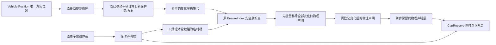

# 路口物理占用增量维护

冻结基线 `baab4676ca23e03c9ccedd859c6e617c6c46371e`；工作分支 `codex/optimize-junction-occupancy-20261101`（开始于11月1日）。本次只改变交通派生索引，不改车辆运动、仲裁、路径、车距、经济或 .05秒规则。正常模拟仍单线程。

## 原来的工作与时序

`MoveStep` 先按不可变车道占用快照收集意图，再按原稳定ID顺序检查/登记预约，最后提交位置。提交后 `indexDirty=true`。下次准入/移动读取索引时，`EnsureIndex` 更新已移动车辆和车道排序，然后清空全部路口声明，扫描全部车辆重新计算物理保护区与ActiveCount。

原 `reservations` 同时承载物理声明与意图阶段的临时通行声明。临时声明即使最终没进入路口，也会保留到下一次 `EnsureIndex`，不能在单车提交位置时提前删除。新增索引必须保留这个延迟清理边界，不仅是保持“每步清一次”的次数。

## 新结构与数据流

`JunctionReservations` 仍是唯一声明所有者：原 `claims` 保存物理声明，另一张同型桶表保存临时声明。冲突判定继续用 `Network.MovementsConflict` 与原零方向保守封锁规则，同owner仍忽略自冲突。临时桶只清本轮实际使用的列表；两层桶空间受当前Network的路口数量限制，拓扑替换时清除旧图关联。

Vehicle只新增两个不保存的索引字段：最后同步的junction和movement，不复制位置。`pendingJunctionOccupants` 只持有需要改变声明的车辆引用。正常运动中位置未变化不重新分类；保护区/方向未变化不调用物理Remove/Reserve。已移动车辆的分类在原提交循环完成，不新增一次全车遍历。真正更新在原索引刷新点，先删后加，避免把离开车辆的旧声明与进入车辆的新声明混为同一时刻。

## 生命周期审计

|入口|维护方式|
|---|---|
|移动提交、跨车道/跨路口、变道完成|复用TrackMovedOccupant；比较同步声明并只标实际变化|
|变道开始|原TryStart只允许保护区之外起步，已有车道shadow立即登记；不提前改预约时序；之后位置提交维护方向|
|发车、拆路后合法重发|原IndexDeparture立即做原准入及物理声明，保持出生时的专有边界优先级；标记可能需要在下一刷新点规范化的声明|
|垃圾车原地换返程任务|CommitContinuation明确标记：位置相同也可能因路线/cursor变化而改变movement|
|到达/业务结束/车辆清退|原ActiveCount减计仍在原提交入口；清退前保留待移除声明的车辆引用，下一刷新点删除，之后释放|
|Freeze、端点增删/可用性变化|已有受控入口标记fullIndexRequired或立即RefreshEndpoints；全量校验/冻结及计数重建保留，不省略端点合法性保障|
|道路编辑、重绑、搁浅恢复、冷读|原Reindex完整回退。含失效路面Stranded的多投影阻挡继续按旧规则建立；它们静止跨步保留，拓扑变更重建|

正常步不再清零/遍历计算ActiveCount与awaitingRestarts：发车、到达、重发、拆路任务结束原本已有增减；全量回退继续从事实重计。没有删安全校验或改变任务生命周期。静态网络、入口存在性、明确结构失效边界仍是正确性的前提；不支持绕过这些入口私改业务事实。

## 正确性证据与边界

`VerifyRoadCore -IndexOracle`通过150937检查，`VerifyCityCore`通过23627城市/10000岗位/1522格网/83分区/460474水电检查。原交通脚本缺少MS018新增的CityRouteGoalBounds文件，补齐编译清单后跑通，没有绕过编译失败。

611项新增检查覆盖物理/临时层、重复声明、原冲突规则、600步冷恢复精确对照、路中前进零物理重写。故意绕过位置通知的负控由独立冻结公式oracle检出；oracle只比较，不Reindex修复被测索引。一个初始中段fixture只注册起点而终点沿用junction，原路由因此从0出发；已补齐双端入口并断言起点20，没有放宽原“中段不重写”断言。

三万和十万人各3000步，对照冻结的World/Occupancy/LaneChanges/Reservations四文件。每Tick记录车辆ID、任务、精确位置、cursor、变道、完整路线和物理+临时声明并累计SHA256；不调用刷新或修复被测索引。轨迹摘要、全部通勤请求结果/顺序、全城检查点与最终保存精确相同，冷续80相同。首个100k测试的旧侧编译早于追踪插桩写入，明确因缺摘要文件失败并保留；带完整追踪的两规模均在新目录重跑通过。

正常复杂度从 `O(V + M + Σ k log k + 全部物理声明冲突重建)` 改为 `O(M + C + Σ k log k + 临时触碰桶)`，C是声明变化车辆及该路口局部冲突检查；原运动循环本身仍处理活动车。没有承诺M很大时为常数成本，也不把移入移动提交的分类成本漏算。完整步/Player净收益必须计入这部分；性能与失效情况另见本轮报告。
