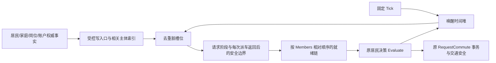

# 统一居民事件调度（2026-11-01）

基线 `e2429c526aca5fd0e05241a29730a0b40e44f427`；独立分支 `codex/resident-event-scheduler-20261101`。按本轮新授权，正常 Editor/Player 默认启用统一事件调度；未合入正式或原百万级执行分支。原来的资金/时间实验报告记录的是当时默认关闭的历史实现。

## 所有权与执行

`CityCoreResidents` 唯一解释通勤/回家规则；`CityResidentSchedule` 只拥有可重建的执行索引。通知只标脏，不派车、不结算、不递归判断资格；安全边界从权威最终事实重新分类。资金通知沿用 MS006 的净资格变化与雇主→员工索引，不新增余额副本。时间安排沿用已有精确 Tick/float 门槛实现，保留 .25 秒重试、日切及保守数值回退。

同一 Tick 按旧 `Members` 相对顺序执行。派车回调使后续居民就绪时，本轮插入其正确位置；已处理的较早居民留到下轮，不倒退执行。资金耗尽也能及时撤掉尚未访问的后续员工。去重的是失效通知，不是业务请求。

## 依赖审计与失效

|依赖|原有事实入口/索引|调度行为|
|---|---|---|
|重试、访问等待、在途任务|retryAt/visitUntil/tripId 受控守卫通知|更新对应居民；精确时间到期唤醒；在途不轮询|
|岗位/工作地点/班次|JobAssignmentsChanged，Employment 的确定性班次计算|只重新判断相关成员；无岗位在家成员等待岗位通知|
|企业资金/开发模式|MS006 FundingEligibilityChanged，绑定账户，雇主索引|净资格变化唤醒员工；模式切换允许雇主级重判|
|健康、能力、死亡、位置、实际到岗、出发/到达日|CityResident 的显式事实属性与 ResidentStateChanged|去重标记有关居民，仍执行原决策|
|家庭住址/居住资格/成员关系/住房可用性|HouseholdHomeChanged、HouseholdChanged、MoveResident、住房→家庭索引|仅相关家庭成员失效|
|实际通勤观察|CommuteObservation 通知|重新计划相关成员，不覆盖权威观察值|
|道路、入口、端点营业/可用性|NetworkGeneration、AccessRevision、EndpointAvailabilityRevision 与端点通知|已计划成员按依赖失效；全局或漏序列版本变化保守失效全部活跃计划|
|日历/日切|固定 Clock、day、secondsPerDay|日切唤醒本日已出发者与活跃计划；不逐步扫描睡眠人口|
|成员增删/冷恢复|新增 MemberStructureChanged 完成后通知|稳定槽位追加/留孔；冷恢复重建，不保存调度数据|

年龄、存款、商店库存等不是通勤决策新依赖；购物仍由 Consumption 的原周期流程处理，不宣称家庭购物已事件化。新玩法加入决策依赖时必须同时补受控写入口、相关主体索引、失效与漏通知负控。

## 数据结构与成本

- 稳定槽位、就绪位图和双向链；遍历只访问就绪成员。非空位图字配 Fenwick 树，插入前驱 `O(log(N/64))`，不扫描全城空字。
- 每居民至多一个时间堆位置；时间更新 `O(log N)`，查询当步到期项，不逐步遍历全堆。
- 扁平三端点依赖结构与端点→相关槽位索引，无每居民小数组。通知去重列表只处理实际变化项。
- 数组几何扩容；删除留孔，超过一半历史槽位被删除才压缩，保持原相对顺序。冷建、扩容、压缩仍 `O(N)`，是明确的生命周期成本，不冒充完全无全局工作。
- 删除居民直接移除其通勤估计，不再每次实体 Revision 变化扫描全部估计字典。道路/入口键仍按原版本验证。
- 常驻空间 `O(N+依赖边)`；不是“百万城市已验收”。集中日切、全城道路变化或大量真实行动仍有成批成本。

## 对照与回退

默认无编译开关即 events；`CITY_RESIDENT_POLLING_REFERENCE` 构建轮询参考。内部 `SetReferencePolling` 仅在健康结构边界切换，可恢复事件索引；不保存为游戏规则，不吞掉错误自动继续。两种路径调用同一决策逻辑；冻结基线独立编译避免共同重构掩盖错误。历史 guard/time/funding 开关仅保留为诊断子集。

复现：`Tools/VerifyUnifiedResidents.ps1 -Mode Controls`，以及 `-Mode Replay -Save <原生城市> -Steps 3000 -Results <新目录>`。`CityResidentScheduleChecks` 补稀疏十万槽位、增长、删除压缩、队列扩容、切换参考、无业转就业检查；其合成人数用例不是十万人实际游玩。

第一轮结果：资金 37 项、守卫 1000 组独立序位及 18 配对场景、时间 13 场景通过；漏通知负控被独立冷状态/原决策对照检出。三万/十万人各 3000 固定步，请求结果/顺序、完整状态检查点和最终保存字节精确一致，冷续 80 步一致。核心 23627、岗位 10000、格网 1522、分区 83、水电 460474 检查通过。新增索引 13 项通过。Player 数据另补，当前不以这些模型成绩声称 FPS 收益。

旧细粒度谓词补丁探针只支持历史内联函数，使用 `-SourceReference e2429c5`；当前版本用 `RunCityScenarioWindow -CoreProfile` 和 `resident-schedule.csv`。不让旧字符串补丁静默漏计新决策内核。

MS018 家庭购物、MS022 正式验收及其依赖状态不因本项改变。本次不修改存档格式、交通物理、经济规则、模拟时间预算或正式分支。
