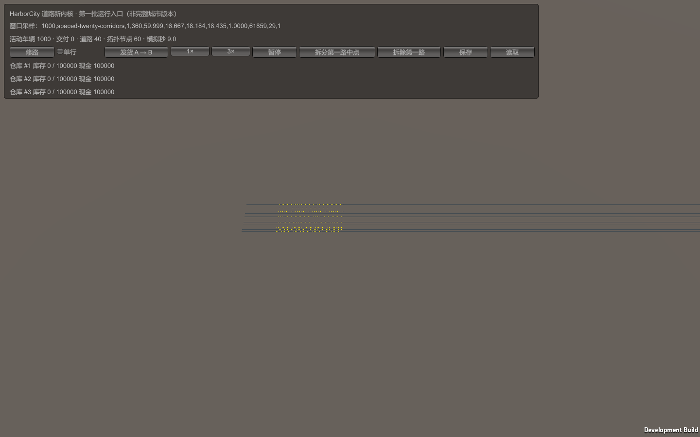

# 第一批新内核性能记录

环境/代码SHA256见 [metadata](metadata.txt)，原始结果：[模型步](model.csv)、[可见窗口](window.csv)、[冷编辑](edits.csv)、[新断言](core-regression.txt)、[保留模块回归](retained-regression.txt)、[Unity独立运行](native.txt)。复现入口见 [本批验收](../../RoadCoreStage1.md)。CPU i5-14600KF，GPU RTX3090，Unity6000.6.3f1/Mono。

模型仅道路/新交通/仓库闭环，50步预热、300步计时，.05模拟秒/步；跟车、预约、提交和结算代码都执行，3000任务都是活动货车，不是道路数或渲染代理数。分散为20个独立走廊，集中为3条进路汇流至5单位出口，收货库存容量0持续形成物理排队。每步检查活动数量，安全检查在计时外。没有降低数量/遗漏必要阶段/丢弃固定步。该矩阵不覆盖所有真实城市拥堵形态。

|场景|活动货车|均值ms/步|P95|P99|B/步|
|---|---:|---:|---:|---:|---:|
|分散|1000|0.313|0.345|0.428|1344|
|汇流排队|1000|0.307|0.470|0.484|320|
|分散|3000|0.973|1.107|1.177|1344|
|汇流排队|3000|0.898|0.970|1.096|320|

分配计数包含计时小开销；每桶排序在Mono上仍有少量分配，不能声称零GC。此处是无渲染模型完整步，**不是全游戏帧时间**。

可见Development Player包含车辆Cube、共享几何Mesh、Update和GUI，1440×900、帧率上限60、关闭vSync，3秒预热/6秒正式记录；源/目的库和任务是真实实体。所有8场景约59.99–60.02FPS，3×实际约3.000（CSV中记录误差可约±.05/6倍，因为只提交完整固定步）；3000车3×P99帧约18.6–18.8ms。Unity `GC Allocated In Frame` 为约16–68KB/帧，`GC.CollectionCount(0)`记录6秒内回收计数，不等于GC暂停耗时。**预热中的对象创建尖峰没有计入稳定态统计，当前GUI分配较高，未测最大帧率/长期堆/GPU瓶颈。** 早期后台黑图/不支持的线程分配0值已淘汰，未作为本表证据。

冷编辑12轮同一冻结新格式状态，测Road1中点拆分、生成新图、整批路线/位置/预约验证、提交和占用重建；装载和事后安全检查在计时外。1000车均值0.855ms、约430KB/提交；3000车约1.980ms、约1.08MB/提交。12轮不足以精确估计尾部，CSV P95/P99均为样本最大值；施工预览尚未实现，因此没有预览性能数字。当前整图冷重建和O(全部任务路线)迁移尚非局部增量事务。

**没有以此宣称原城市7–8ms降至1ms。** 原城市有不同的居民/货运/服务/行人/换道/信号与逐车更新语义，新入口暂未接回；无法做有效的同城等价配对。原测量仍保存在历史目录，回退靠110c4ea基线分支。本批结果建立新模型可重复基准，后续每批在相同新存档/车流上配对，再恢复原城市业务测量。
