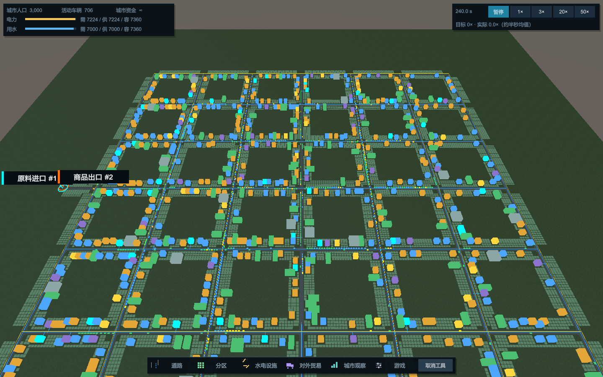
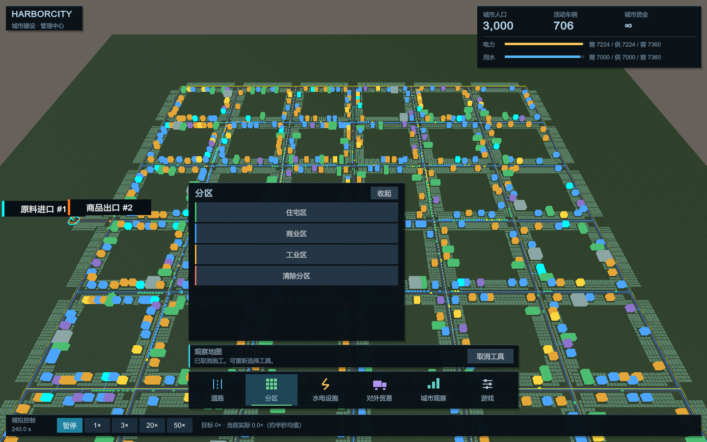

# 紧凑角落布局调整（2026-10-20）

按玩家反馈缩减常驻遮挡：左上角 408×78 以内集中人口/车辆/资金/水电，右上角 352×64 以内放模拟时间、暂停和1/3/20/50倍及实际速度；删除独立品牌块。底部只保留 40 像素高的一行图标+文字分类按钮和取消工具，不再有底部时间条、两层图标文字或常驻提示栏。详细选项点击分类后展开，操作提示变为顶部4秒短提示，完整工具说明仍在分类面板内。三个详情面板同步避开新的底部一行工具。

Unity 编译及现有工具/Layout/Repaint/主题恢复/输入边界测试通过，新增左右角落不重叠和底部40像素约束；1440×900与960×600真实Player逐页截图及完整城市状态不变检查通过。原始材料本地 Temp/CompactCorners-20261020，不宣称性能改善；图示是实际Player画面。此节布局取代下面第一版布局。

---

# HarborCity 游戏 UI 改版（2026-10-20）

参考《都市：天际线 II》官方道路工具介绍及游戏内的分类工具/上下文选项思路，制作 HarborCity 自有界面，不复制其美术资源。参考：https://www.paradoxinteractive.com/games/cities-skylines-ii/features/road-tools 。

- 底部六个手绘几何图标入口：道路、分区、水电设施、对外贸易、城市观察、游戏。分类选中底色/色条、悬停反馈；同类再点收起保留工具，换类取消旧手势。
- 工具选项按需弹出，扁平深蓝卡片与清晰字号。道路和方格工具有选中状态，住宅/商业/工业使用真实分区颜色；设施也有类型色条。
- 右上角三列显示真实人口、活动车辆和资金；水电条和数字保留需求/实际供给/容量，短缺变色，不加入虚构需求或统计。
- 最底部单独放模拟秒数、暂停及1/3/20/50倍和真实推进倍率；施工提示与取消操作位于工具栏上方。
- 地图世界标签置于 HUD 下面绘制；选路/建筑观察和财政面板避开底部操作条。Esc 取消当前工具并收起相关面板。左上品牌条外的地图保持可操作。
- 修正基础设施定位到大地图左侧边带 (-660,0)，沿用原道路、分区、供给、财政和存档命令。未修改模拟或 .hcity 格式，没引入第二套 UI 数据源。

实现继续复用现有 IMGUI 宿主和工具，主题限于绘制作用域，恢复原 GUISkin/颜色；主题实例由宿主销毁，图标用代码绘制且不创建逐帧纹理。

验证：Unity 编译及 Layout/Repaint 六分类、主题状态恢复、输入遮挡、分类收起/切换、32×32预览、接边/重叠反馈、扣款及框选分区回归通过；真实 Windows x64 Mono Player 对三千人存档的概览与六个页面逐页渲染，完整城市保存字节保持一致；1440×900 与960×600实际截图检查。初次隐藏窗口截图全黑，未采用为视觉验收，改用正常窗口重新截取；截图检查后修复小按钮换行、文字内边距及世界标签遮挡提示条。程序化操作不冒充人工鼠标试玩，本次不宣称 FPS 提升。原始截图、日志与构建本地保留 Temp/CityUI-20261020。

`HarborCityUICapture` 仅显式 `-harbor-ui-capture <目录>` 启用的诊断截图器，正常 Play 不创建；配合 inspect 保存逐页捕获且核对全城状态，不参与运行规则。

实际 Player 分区面板：

