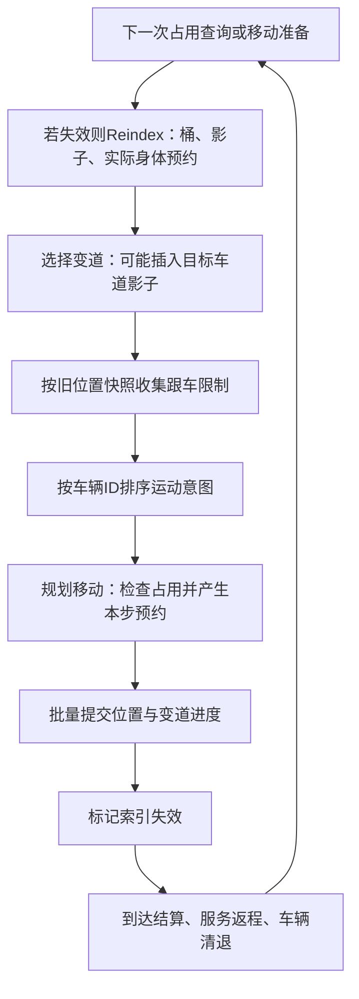

# 车辆占用索引与移动：依赖及增量维护研究

结论：**索引增量维护值得继续实验，但本轮没有证明一套可替代全量Reindex的实现。** 最新三万人Player中，占用重建约 **2.21ms/步**，移动扣除其内部索引工作后约 **3.02ms/步**；两者合计约5.23ms，不能重复相加移动内的索引计时。77.52%的运动提交未改变车道锚点，普通车辆生命周期和路口临时预约则要求增量方案覆盖更多写入点。

本轮只提交独立诊断工具、隔离的小实验和报告。**正式开发仍停在0bbd20f，未修改主开发Assets，未改通勤缓存、居民调度、交通规则或固定步。**

## 条件与数据来源

- 基线：`0bbd20f0a255a7055a6f0ad4a971a265e18531e7`；独立分支：`codex/diagnose-occupancy-movement-20261026`；工具/报告SHA见Git历史，不自动合并。
- 原真实三万人存档：`C:/Users/16934/Documents/unity_game/test/Temp/CityScenarios/regenerated30000-20261017/city.hcity`，SHA256 `3F49BD1A02879BB686C24D5517902CC581C657220CE2B955107D89B6FA870B4E`。
- i5-14600KF、Unity6000.6.3f1 Windows64 Mono Release、1440×900、全部显示。2400实际固定步＋8秒显示预热；测量tick7201—7800，600个0.05秒步。200座垃圾场保持现有共享点查询策略，不重新研究缓存冷启动。
- 复用现有Player工具。每渲染帧脚本推进一个完整固定步，宿主不另行推进，保证相同工作量；**这里不是正常50×FPS测试，不能把CPU差值换算成FPS或模拟倍率。**
- 两轮分项计时，一轮变化统计，一轮空桶判断实验，两轮非空桶排序实验，两个无细分埋点对照。计时版本没有逐车计数/逐车计时；统计版本增加了只读遍历及声明计算，整体耗时不用于性能比较。

## 依赖链：索引和移动不能拆成互不相干的系统

`VehiclePosition.Commit`更新唯一车辆位置；`LaneOccupant.distance`是派生值，不随该调用自动更新。仅删除`indexDirty=true`会留下旧距离、旧车道成员、变道影子和预约。

移动使用**步初占用快照**：先统一算跟车限制、按ID仲裁，再统一提交。不能边处理每辆车边把新位置用于其他车的本步跟车判断，否则规则会改变。

`JunctionReservations`也不是永久持有的占用表：Reindex重建实际车身所在区域的声明；移动规划会再Reserve尚待通过的区域。保留上一帧全部预约会把临时声明当成实际身体占用，可能阻塞或死锁。当前Reset本身很便宜，逐车计算/登记预约的成本包含在RegisterActors中。

## 独立耗时，原方案两轮均值

| 索引阶段 | 每步CPU |
|---|---:|
| 清理历史桶 | 0.235ms |
| 重置预约及计数 | 0.011ms |
| 逐车登记：状态检查、身体/影子、身体预约 | 1.082ms |
| 桶排序 | 0.881ms |
| Reindex合计 | **2.209ms** |

| 移动阶段 | 每步CPU |
|---|---:|
| 准备时触发的Reindex | 约0.258ms，下面独立移动已扣除 |
| 自动选择变道 | 0.470ms |
| 清理本步缓冲 | 0.012ms |
| 从桶快照收集意图及跟车限制 | 0.663ms |
| 按车辆ID排序意图 | 0.604ms |
| 推进意图：跟车、跨段、路口/出口检查及预约 | 0.898ms |
| 提交位置、变道完成及到达记录 | 0.373ms |
| 移动原始inclusive | 3.280ms |
| **移动扣除其中Reindex** | **3.022ms** |

不能使用2.209＋3.280作为独立总和；应使用 **2.209＋3.022＝5.231ms**。同理，上一轮被计入居民派车的重建只是首次查询承担的共同工作，不是本轮新的额外成本。细项见[phases.csv](phases.csv)、[movement-exclusive.csv](movement-exclusive.csv)。

收集＋排序意图约1.267ms，占独立移动约42%。真正推进意图＋提交约1.272ms；“移动慢”不能全部解释为积分或跟车公式慢。后续可研究维护派生的稳定ID顺序，避免每步全局排序，但必须保留原ID仲裁和旧位置快照，不能直接改按桶遍历顺序执行，也不能默认所有合法读档的车辆列表已按ID排序。

## 实际变化量

| 600步统计 | 总数或均值 |
|---|---:|
| Active运动提交 | 2778051，约4630/步 |
| 车道锚点Current/Distance未变 | 2153564，**77.52%** |
| 同一Drivable内前进 | 608061，21.89% |
| 最终Drivable变化 | 16426，**0.59%** |
| 自动变道开始 / 完成 | 328 / 318 |
| commit前后身体声明签名改变 | 16105，约26.84/步 |
| Reindex遍历历史桶 | 7208677，约12035/次重建 |
| 其中非空桶 | 537592，约898/次，只有7.46% |
| 移动造成距离变化的桶 | 平均685/步 |
| 移动/变道造成成员变化的桶 | 平均55/步 |
| 发车登记 / 车辆清退 | 1217 / 1584 |
| 发生清退的模拟步 | **544/600** |

这里的“未变”是车道锚点，不等于变道横移画面不动；变道进度仍推进。身体声明签名只比较commit前后，变道开始另计。脏桶统计覆盖移动与新影子，不是全部生命周期脏集，不能漏算到达清退、服务继续运输等写入。

约685个距离脏桶已经覆盖多数当前非空桶；不能用“77.5%锚点未动”直接推算排序或整个模拟也可省77.5%。如果能证明同车道有序性持续成立，才可以减少距离变化后的重排；否则第一版应保守地排序受影响桶。

数据见[occupancy-counts.csv](occupancy-counts.csv)、[occupancy-steps.csv](occupancy-steps.csv)。本窗口注册访问中没有Stranded或AwaitingRestart，不能用它证明这些场景的增量正确性。

## 两个有界实验：没有把局部数字当成整体验收

1. **空桶不Clear、0/1元素不Sort。** 全量车辆登记、预约、桶遍历仍保留。单轮索引2.138ms/步，原两轮2.209ms/步；清桶/排序没有出现与92.54%空桶比例相称的下降。整步10.493ms，但其他移动阶段也变快，不能把整步差值全算作本改动收益。
2. **本次重建中收集非空桶，只排序该临时列表。** 列表每次Reindex重建，覆盖身体、影子和冻结映射；不把它当长期成员表。两轮排序平均0.760ms，对照0.881ms；但逐车登记增加了收集开销，索引合计仅2.170对2.209ms，整步10.721对10.784ms。第二轮整步反而略慢，**没有可靠整体收益，不建议据此合入**。

这些都是Temp对照，不是已经完成逐车增量。它们仍登记全部车辆和全部身体预约。无细分埋点的新构建对照为10.796ms/步；复用旧Player的一轮为11.564ms，整体进程间波动也记录在[windows.csv](windows.csv)，没有选择有利对照宣称提速。

## 推荐的下一项最小增量实验

**优先覆盖普通移动及普通生命周期，保留冷恢复/结构编辑的全量回退；暂不同时改移动规则。**

- World继续唯一持有派生索引，在已有批量commit循环记录旧/新Drivable、距离、影子；未变的身体条目复用，同车道更新距离，跨段移除/插入，变道维护两份占用，收集脏桶。
- 同一阶段必须覆盖`IndexDeparture`、`LaneChanges.TryStart/Choose`、`AcknowledgeArrival/RetireCompleted`和`CommitContinuation`。尤其不能在每次普通清退时全量回退：本窗口544步有真实清退；`RetireCompleted`当前即使没有清退也无条件置脏。
- 第一版可以继续重建身体预约，以降低风险，但要**承认仍有全城遍历**，独立测量其成本。进一步减少预约登记时，需明确区分真实身体声明与本步临时规划声明，按车/路口移除与更新，保留零movement的保守冲突规则。
- 道路新增/删除/拆分/升级、入口有效性变化、失去路面/恢复、冷读取暂保留原全量路径。普通车辆到达、发车和服务续程则应局部处理，否则收益会被日常回退吞掉。

正确性先用影子模式验证：**在原`AssertSafety()`之前**比较有序桶、精确距离、影子成员、身体预约与候选结果。它当前会强制Reindex，先调用它会修复候选索引并掩盖错误。还需旧/新完整模拟对照和不被校验重建干扰的连续运行测试。

覆盖清单包括单/双向多车道、曲线/高程、同距ID顺序、变道开始/中途/完成、零长连接及一帧跨多段、路口冲突、出发占用、到达清退、服务续程、拓扑编辑/失败回滚、Stranded/重启、存读档。**本轮没有实施这套增量，不能把这些未测试项写成PASS。**

## 验证与交付

8个原生窗口均通过城市Validate、完整终态对照及20步热/冷恢复；初态SHA均为`a24604bb9e10c6acb5c9f7a2922f3394b6e52ef027e1b281e7d964324dae8ec5`，终态均为`19e1a1d8f37803f06e695377d15930c3909356a0be3872b0edce9f9838c43d5b`。7个正常退出；空桶判断实验在结果写出、关闭阶段超时，不能称关闭流程PASS，见[validation.csv](validation.csv)。

托管分配API/Release GC字节Recorder不可用，没有伪报零分配或内存节省。未重建昂贵城市，未增加保存适配或性能归档框架；原Player/日志/大存档保留本地`Temp/ResidentScheduling`。正式分支、4个用户未提交文件与原存档保留。

复现使用现有`RunResidentSchedulingDiagnosis.ps1`：`occupancy`＋`occupancy-timing`测粗阶段，`occupancy-census`＋`occupancy-counts`做变化统计，`occupancy-trim`/`occupancy-active`是隔离对照。补丁只作用于Temp项目；没有正式算法收益或新的正常FPS成绩可发布。
