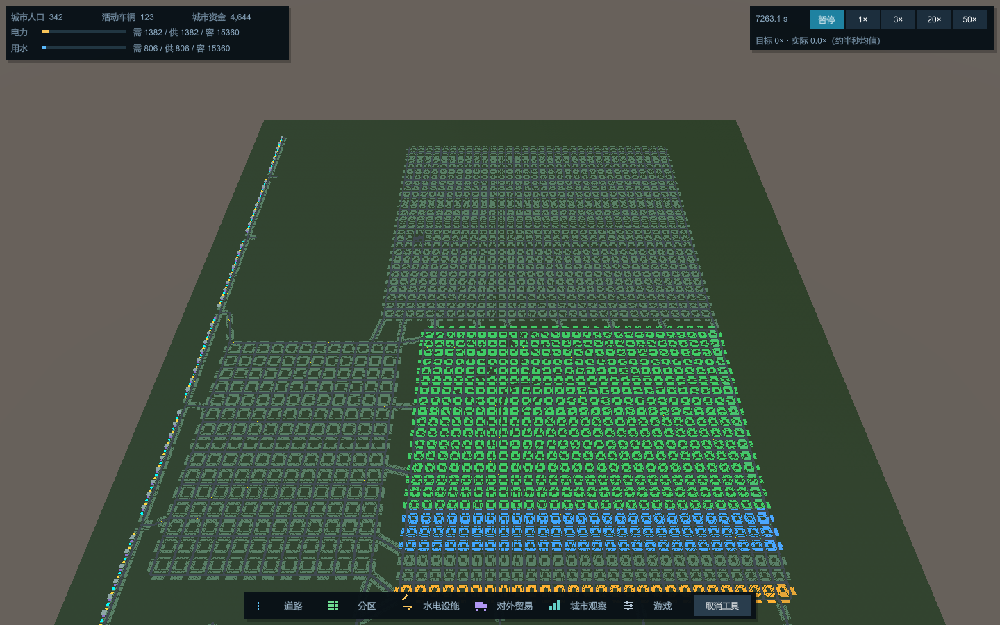

# 道路空间合批实验：2026-10-22

结论：完整保留道路画面的情况下，大路网道路 Renderer 从 97,120 降到 347；普通 Release Player 暂停从 33.99 提高到 60.04 FPS，50×目标下从 24.49× / 31.43 FPS 提高到 43.56× / 53.18 FPS。最终二进制复测为 43.43× / 53.19 FPS。没有达到 50×，施工事务本身和模拟长帧也没有被本轮解决。

实验分支：`codex/experiment-road-view-batching-20261022`。基线：`20573fec96cb5d7b6fa533c4b0686dde972150b3`，从当前诊断分支 HEAD 创建，未合并或修改原分支。

## 测试条件与版本

- Windows 11，i5-14600KF、RTX 3090，Unity 6000.6.3f1，Windows x64 Mono，1440×900，相同全城固定相机和画质，VSync=0，目标 60 FPS。
- 真实玩家存档有 **331 人、3,562 条物理道路**，不是三万人城；预热测量起点为 342 人、565 建筑、125 活动车。小城为已有 3,000 人、85 道路场景。未重新生成或减少业务数据。
- 原始输入：`Temp/Speed50Analysis-20261021/input.hcity`，SHA256 `2589d2a9ab888aa48998dc84cbfbb2c76534847099a97b28eba4b9789c729be4`；小城 `Temp/CityScenarios/regenerated3000-20261017/city.hcity`，SHA256 `35411ad5df2241625c35d3d54492544b435bbb17f83c4dd7ca0c685308799780`。
- 每次相同输入，200 旧步、全部基地双向 D 树预建、4,000 正常 D 步，再暂停显示预热 8 秒。大图 96 基地 / 192 树，小图 20 / 40。所有测量窗口建树、展开、未命中、失效、淘汰均为 0，查询全部命中。大图共同起点 tick=145241，完整预热保存 SHA256 `9a942d11acff321a6eb961ff5fa3096df22f72718f5157b1144cdf78ac5b9371`。
- **D 寻路实验仅由诊断参数启用**，正常游戏默认开关未变；8ms / 32 步预算、0.05 秒固定步和欠步规则未变。此成绩不能直接推断关闭 D 实验的正式开发版倍率。
- 普通 Release 大图每窗 20 秒，小图 15 秒；Development Profiler 另测，不能混作 Release 成绩。27 个窗口及版本、输入、DLL 校验值见 [summary.csv](summary.csv)。
- Release 冻结基线复用既有 `970ce6b41876de02850b1c982d5a0e2a1957b403` 二进制，其道路渲染实现与 20573fec 一致；第一版 Release 为 `5543968`，最终 Release 为 `933898619dd83c0bb938f0f9dd75d366132d6218`。Development 配对宿主为 `57354cb`，旧渲染器仅从 20573fec 注入临时测试项目；原始编辑采样新宿主为 `9d21d93`。逐窗口源码和 DLL 哈希保留，避免将脚本版本误当二进制版本。

## 普通 Player 配对结果

| 真实大图 | 旧 FPS | 新 FPS（64） | 旧实际倍率 | 新实际倍率 |
|---|---:|---:|---:|---:|
| 暂停 | 33.99 | 60.04 | 0 | 0 |
| 1× | 33.94 | 60.02 | 1.00× | 1.00× |
| 50× | 31.43 | 53.18 | 24.49× | 43.56× |

| 真实大图帧耗时，ms | 旧 P95 | 新 P95 | 旧 P99 | 新 P99 | 旧最长 | 新最长 |
|---|---:|---:|---:|---:|---:|---:|
| 暂停 | 31.98 | 16.84 | 34.37 | 16.91 | 42.07 | 17.09 |
| 1× | 32.64 | 18.43 | 34.36 | 18.62 | 47.84 | 34.08 |
| 50× | 40.51 | 24.51 | 137.80 | 123.78 | 205.23 | 213.54 |

暂停平均帧 29.42→16.66ms；50×平均帧约 31.82→18.80ms。50× FPS 提高约 69.2%，实际倍率提高约 77.9%。**最长模拟帧没有改善**：吞吐提高也意味着相同实时时窗内执行更多业务，增长等长帧仍存在，不能宣称消除了全部卡顿。

最终代码另跑暂停及 50×：60.04 FPS；43.43× / 53.19 FPS，50× P95=24.38、P99=125.72、最长=211.43ms，支持前述收益。

| 分块尺寸 | 实际 Renderer | 暂停 FPS | 50× FPS | 实际倍率 |
|---|---:|---:|---:|---:|
| 32 | 1,239 | 60.02 | 53.16 | 43.62× |
| 64（默认） | 347 | 60.04 | 53.18 | 43.56× |
| 128 | 106 | 60.04 | 53.46 | 43.74× |

三种尺寸单轮差别很小，不能据此认定 128 普遍更快。选择 64 平衡 Renderer 数、块范围和局部重建范围；尚未做所有近景视角的矩阵测试。块按实际几何边界计算 Bounds，长道路跨块分段，不会因一个长道路产生全城巨大 Bounds。

小城本来接近帧率上限：暂停 60.03→60.03 FPS；50×为 41.38× / 59.72 FPS→41.47× / 59.76 FPS，无显著性能提升，Renderer 604→36。没有将小城噪声宣传为收益。

## 渲染、内存与 GC 证据

同配置 Development 原始采样，各取 119 个完整帧。暂停时 Render Thread `DrawBuffersBatchMode` 平均 **15.864→0.371ms/帧**；Main Thread `ExecuteRenderQueueJob` **4.034→0.032ms/帧**。50×分别为 15.959→0.198ms、4.034→0.038ms。两个线程可重叠，不能相加作帧耗时。详见 [profiler-summary.csv](profiler-summary.csv)。Profiler 自身内存计数刷新会明显拖慢旧版，只用于定位，正式成绩取普通 Release。

同 Development 暂停起点：道路 Mesh 的 Unity runtime 估计 **334,464,612→229,901,304 字节**，约减少 31.3%；Unity 总 allocated 835,092,691→452,788,491 字节。全进程 `GC.GetTotalMemory(false)` 为 806,993,920→754,294,784 字节，包含尚未回收对象，不能据此计算精确道路缓存驻留量，也不是 VRAM 测量。Release 与 Development 的 Mesh 统计不能交叉对比。

Development 暂停 GC 约 6.51→6.49KB/帧，基本相同。50×每帧业务工作量不同，不以 GC/帧降低证明模拟分配改善。普通 Release 本机 GC recorder 不可用（-1），没有补造数据。Draw Call/Batches recorder 同样不可可靠读取；Renderer 数不是 Draw Call 数。

## 实现与更新方式

`HarborCityRoadViews` 原来为每条非零长度 Lane / LaneConnection 创建独立 Mesh、GameObject、MeshRenderer。新实现为表现层维护：Drivable ID→原不可变几何及分块片段、Chunk→成员 ID、Chunk→自有 Mesh/Renderer。权威 Network 不变。

原始 Ribbon 的采样循环抽成 `HarborCitySurfaceMesh.RibbonVertices`，计算结果不变。按原有每个四边形重心划入世界坐标块，仅在已有四边形之间拆分，不裁剪、简化或删除三角形。每条原 Ribbon 用一个可复用 scratch Mesh 计算原始 Unity 法线，再复制到块，避免边界重新平滑改变画面。共用原材质、原世界坐标、单位 Transform；大块使用 UInt32 索引，Bounds 来源于实际顶点。

Network 改变后比较 Drivable ID/几何，将新增、修改、删除的旧新块标脏，只重建这些块的成员；其余原对象和 Mesh 保留。先完整构建禁用的替代块，全部成功后才交换；失败保留原显示。资源所有者唯一，释放自有 Mesh/GameObject/scratch，不释放借用材质。

世界替换、读档/换城、地形采样器变化或显式地形失效仍全量重建，因为全部高度可能变化。仅速度变化、不影响几何则不重建。**目前 Network 变化仍需 O(全城 Drivable 数) 差异扫描**；几何生成和 Mesh 替换局限于脏块，没有伪称完全局部复杂度。视图缓存不保存、不参与路线或模拟。

## 道路施工与生命周期

真实大图暂停、125 辆车保留，用正常合法性查询及 Construction.Commit 新增道路，再执行宿主显示同步；冷建树、保存断言在施工计时外。

| Development 实际施工，ms | 旧 | 新 |
|---|---:|---:|
| 规划+提交 | 227.27 | 233.70 |
| 道路显示同步 | 11.29 | 13.71 |
| 整窗最长帧 | 315.11 | 293.48 |

成功扣款均为 320，4 个新 Drivable；新方案仅创建 4 块，原 347 块全部复用，未重建全城。**同步略慢约 2.4ms**，不宣称施工事务优化；它仍约 230ms。另做 raw 定点采样，道路同步 marker 10.578→11.520ms，GC 10,576→33,088 字节；其中 BuildChunks 仅 0.251ms / 28,088 字节，其余主要是差异扫描。以上是隔离显示的暂停施工，不冒充正常运行鼠标点击延迟。新旧施工后的完整存档和截图相同。

曲线、坡地、跨块、拆分、拓宽、反向、删除、连续更新、速度变化、地形更新/异常回滚、加载/切城/Clear/Dispose、在途车辆及失败事务由原生 Unity 检查覆盖。密集单块 87,600 顶点验证 UInt32；Dispose 后没有遗留本类拥有的道路/临时 Mesh，不等于证明整个引擎长期零泄漏。

## 正确性与边界

- 冻结 20573fec 原始 SurfaceMesh 对照：35 个几何案例、32,534,341 项元素断言通过，位置/法线浮点位、索引、三角形朝向及完整覆盖一致。Bounds 包含检查容差 1e-4，几何等价断言没有放宽。
- 大图原 3,838,752 顶点，新 3,862,278（边界重复约 0.61%）；**三角形均为 3,644,512**。逻辑 Drivable 仍为 97,120，实际 Renderer 为 347，减少 99.64%。
- 7 组完整 1440×900 RGBA 对照：32/64/128 大图、小城、两种施工配对、最终版本重复均 **0 像素差异**；对应 7 组完整原生保存逐字节一致。见 [pixels.csv](pixels.csv)、[state-equality.csv](state-equality.csv)。
- 新旧原生 1×结束同 tick 大图 145641 / 小图 9300，全部交通保存字节和完整业务 DTO 一致；仅对 DTO 副本排除已独立核验的实时时钟欠步小数，原世界/存档未改。不同性能产生不同墙钟债务，不宣称活动窗口存档逐字节相同。
- 原有道路显示 17 项回归、CityUsability、原生工业/车辆变道拆路/保存继续、真实 InputSystem 两次点击施工/分区/建筑增长/迁入/通勤与在途保存回归通过。属于自动化原生交互，未宣称人工鼠标体验验收。
- 27 个窗口均验证完整步数/倍率账时、车辆显示数、保存恢复后继续 20 步、安全状态。单一运行系统及 PowerShell 解析检查通过。没有新增旧存档适配，也没有改变保存格式。

## 数据、复现与建议

代码阶段提交：`5543968`（合批/局部重建及几何测试）、`57354cb`（真实施工与冻结渲染控制）、`9d21d93`（原生状态与 raw 施工采样）、`9338986`（诊断对象统计与互斥检查）。最终文档提交见本报告 Git 历史。

复用 `Tools/VerifyRoadViewBatches.ps1`、`Tools/RunCityScenarioWindow.ps1`、`Tools/VerifyCityScenarioWindow.py`；逐窗口完整配置在本地 `Temp/RoadViewBatching-20261022/<case>/environment.json`。必要汇总：[summary.csv](summary.csv)、[frames-main.csv](frames-main.csv)、[memory.csv](memory.csv)、[cache.csv](cache.csv)、[road-edits.csv](road-edits.csv)、[geometry.csv](geometry.csv)。原始 Profiler、Player、日志、保存继续留本地，绝对路径及校验值见 [captures.csv](captures.csv)，不上传大型二进制。

道路提交瓶颈明显改善，建议将**道路表现层改动**单独评审移入正式开发；本分支祖先含尚未批准的垃圾寻路实验，不能据此建议整分支直接合并。未自动合并。

剩余优先项是原诊断已证实的增长/交通/居民模拟长帧，以及道路施工差异扫描和约 230ms 事务；本轮均未修改。尚未覆盖所有近景视角、超大方格批建和长时间驻留压力，不把当前固定全城配对扩大为所有场景保证。后续独立任务再处理，本轮到此结束。

