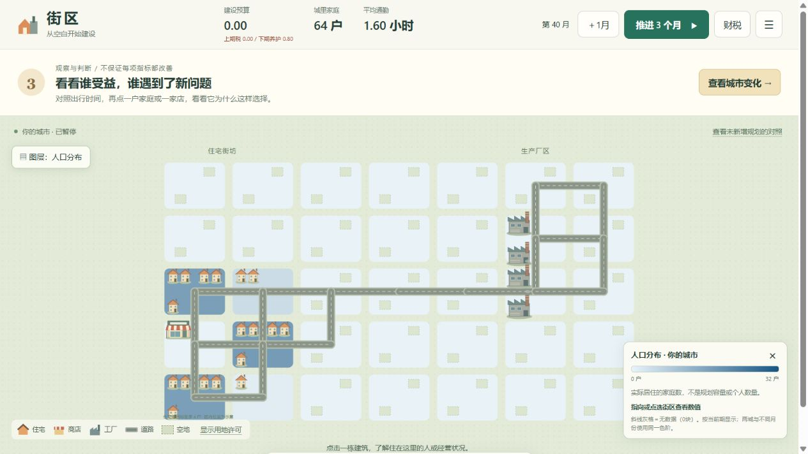
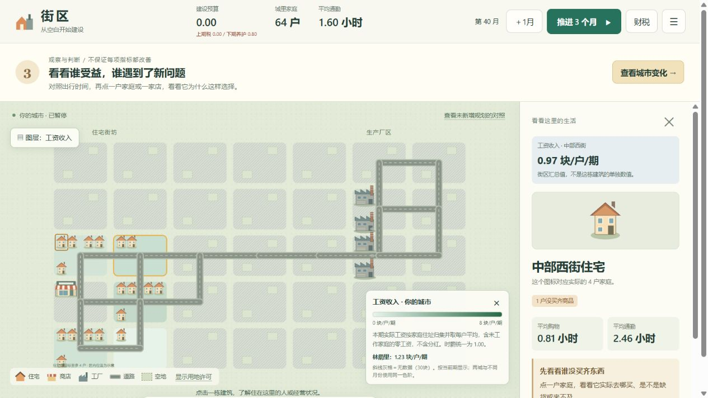

# 左上角城市图层

地图左上角点“城市图层”，选一项即可按颜色看分布，菜单自动收起。选数据图层会切到“查看城市”，避免下一次点地图误施工。之后仍可主动选修路或规划工具，图层会保留；许可继续通过虚线边框和标签表示。

真实房屋、商店、工厂与道路继续绘制在颜色上方，没有添加建筑或经济活动。指向地块或建筑可看图例中的街区数值，点选后右侧也显示该街区的汇总值，明确不把街区均值当成某栋建筑或某个家庭的数值。

## 指标口径

| 图层 | 数据与单位 | 色阶 |
| --- | --- | --- |
| 人口分布 | 实际居住家庭数量，户；没有换算成个人数量 | 0–32 |
| 住宅租金 | 当前每户每期报价，块；仅现有住户或住宅许可地块显示 | 0–2 |
| 工资收入 | 本期实际生产、柜台、零售和货运工资，按结算后住址计算每户税前均值；包含未工作家庭的零工资，不含分红 | 0–8 |
| 税后总收入 | 实际工资和分红减去实际收入税，按住址计算每户均值；不是现金余额，也未扣房租、购物等支出 | 0–12，12及以上同深色 |
| 通勤时间 | 本期实际通勤按住址计算每户均值，包含无通勤家庭；不是最近工作地点距离 | 0–8小时 |
| 购物缺口 | `(Σ家庭[4－食品消费－日用品消费])÷家庭数`，每户未满足商品件数 | 0–4件 |
| 生产干扰 | 原模型按实际产量与几何距离计算的指数，没有现实污染浓度单位 | 0–2，2及以上同深色 |

人口上限32来自每块8单位土地、每单位可承载4户的模型容量。其他色阶同样固定，不随某次样本最大值自动变化。玩家城市、对照和不同月份使用相同阈值；高值截断在图例说明，悬停和面板仍显示未截断的真实数值。深色只表示数值高，不代表经济更好。

没有家庭的地方，收入、通勤、购物缺口为“无数据”，显示斜线灰格，而不是填零。空白规划阶段只有人口零可显示；刚开放但尚未结算时，工资和消费等也为无数据。住宅空地可以有租金报价，但不能因此绘制出住户或建筑。

当前没有土地买卖价格模型，因此菜单将“地价”标注为未建模，不可选；住宅租金不能替代土地售价。当前每小时工资统一为1.00，所以展示的是实际工资收入差异，没有虚构时薪竞争。

`landlab/layers.py` 只读取模拟状态和真实现金交易。`layer_data` 是 `/api/state` 中的展示字段，不写入模拟快照，不参与主体决策。旧服务仍可显示已有的人口、租金数据；其他图层若缺接口会提示重启，不把缺字段当零。

## 浏览器验收

使用独立副本，没有改变玩家原存档：

- 第40月人口图显示西侧19户、20户的街区比1户、5户的街区更深，东侧工业街区人口为零，建筑和道路仍清晰可见。
- 工资图中，中部西街为每户0.97、林荫里为1.23；30个没有住户的街区显示无数据。点住宅后右侧显示相同街区指标，并可继续检查具体家庭。
- 推进到第41月，中部西街工资均值随真实结算更新为1.49；切换对照后相应街区为1.73，使用同一色阶。
- 对照的住宅租金图显示中部西街报价0.69；无住户的工业街区没有住宅租金，也没有被制造土地价格。
- 在推进之前，仅选择图层和检查主体后，完整模型快照与原始副本一致，修订号仍为169。
- 76项测试通过；另补充验证了已有住户在改为商业许可后仍能显示住宅租金报价，并核对收入、税和购物缺口聚合与原始交易、主体状态一致。

如果 Python 服务仍在运行旧代码，请先运行 `stop-land.cmd`，再运行 `run-land.cmd`，从当前存档继续。没有新增经济机制，也没有修改正式游戏。
