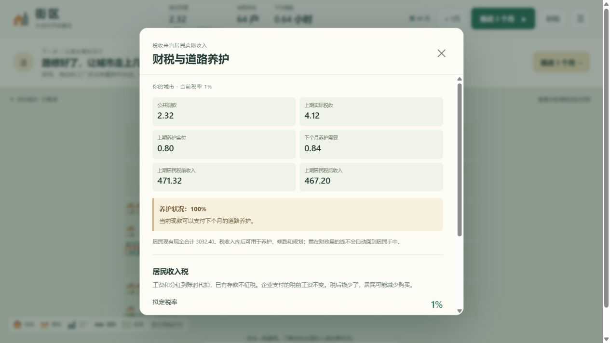

# 收入税与公共养护

## 实际游玩复盘：第65—94期30%，第95期起1%

2026-10-29只读检查玩家第103期存档，种子1。操作记录为第64期结束后改30%，第94期结束后改1%，之后无新增规划。以下分析没有推进或替换玩家的原存档。

从空白规划、随机种子和操作记录重放，全部核心经济快照与真实第103期一致。运行中的存档仍采用此前的随机商业考察版本；本次重放及所有税收对照都明确保留该版本，只改变税率，不混入新的轮查规则。额外从第64期相同状态分出0%、1%、持续30%、30%后降1%四条路径。实际税率路径的核心快照也完全复现真实第103期。网页原对照从第0期分叉且未接受后续道路规划，不能直接当作纯税收对照。

数据副本和逐期结果在 `outputs/tax-diagnosis/`，其中 `original-save.json` 为只读导出的原存档，`series.json` 含实际重放及四组同初态对照。

### 实际发生了什么

- 第64期结束：公共现款22.74，64户家庭合计现款3857.15；食品和日用品目标购买量均满足。
- 第65—94期的30期高税，共征税3811.55，养护仅支出20.40。公共余额达到3813.89，家庭现款降到991.79。全城固定现金总量5160.00，约73.9%集中到公共账户。
- 高税后期不是所有家庭同样穷：第94期家庭现金中位数仅3.645，37/64户不足5.00。应看分布，不能只用平均存款掩盖现金紧张。
- 第85—94期每期平均有19.4户出现模型的“预算不足”标记（未形成方案且现金不足1.00，或未买齐且购物现金不足3.00；不是19.4户完全不购物，也不是严格的因果归类），平均食品目标满足率91.1%、日用品65.9%。第94期单期日用品满足率53.9%。满足率按目标件数计算，不是“买齐的家庭占比”。
- 第94期结束后改成1%。第95—103期购物预算压力缓解：上述预算不足标记户数平均12.56，当前家庭现金中位数回到5.465，现金不足5.00的家庭降为16户；但家庭合计现金仍只有951.15，公共账户3835.44。降低以后收入的税率并不会自动返还以前征走的钱。

### 同第64期初态的税率对照

| 指标 | 后续一直1% | 第65—94期30% |
| --- | ---: | ---: |
| 第65—94期平均每期消费额 | 309.24 | 288.11 |
| 同期食品目标满足率 | 98.7% | 96.0% |
| 同期日用品目标满足率 | 95.5% | 84.8% |
| 同期平均每期产量 | 266.40件 | 249.03件 |
| 同期平均每期实际劳动 | 93.06小时 | 88.85小时 |
| 第94期家庭合计现金 | 4567.31 | 991.79 |
| 第94期公共余额 | 122.77 | 3813.89 |

因此高税不是只改变账面归属：同初态对照中，消费额低约6.8%，日用品满足率低约10.7个百分点，产量与劳动也下降。前期存款缓冲了影响，后期现金紧张才明显恶化。

降税也有可观测作用：若第95期继续保持30%，第95—103期平均消费140.16、日用品满足率34.8%，第103期家庭合计现金392.52；实际降到1%后为234.04、61.3%和951.15。若第65期起就一直维持1%，该后段日用品满足率约90.6%，家庭现金4602.99。降税能止损，但不是立即恢复到未经历高税的状态。

0%也不是长期最优结论：第65—94期0%与1%的消费和产量相同，但0%公共账户在后续耗尽，养护不足、通路变慢，后段表现变差。1%在这个布局的试算里已经足以覆盖每期0.68的现有养护；这不是所有地图和时期的通用最优税率。

### 为什么会这样，以及不能归因给税的部分

税对真实工资和家庭分红逐笔代扣，非直接向工厂利润征30%，也不直接没收原有存款。居民继续交租、消费；原本会回流到居民的收入和分红在反复流转中被抽入公共账户。期间没有新增公共建设，只有很小的养护支出，绝大部分税款留在公共账上。高额公共存款不会自动成为居民或创业资金。

模型于是出现“政府有钱、部分家庭现金不足、购买下降、企业销量与用工下降”的链条。当前没有退税、补贴或广泛公共服务支出，这也是财政玩法尚不完整的表现，而非现实世界的普遍税率结论。

不能把所有商业失败都说成高税造成：商业在征税前就反复亏损退出。第94期实际创业池61.14，而一直1%的对照也只剩81.71，后者同样继续经历门店进退；资金池耗损还受经营预测偏差、库存、退出损失等既有问题影响。当前第103期没有营业店，新投资所需最低资金通常约89.60，资金池61.14构成另一个阻挡。降低居民税不会直接给创业池补钱。四家工厂中两家长期零产量的格局也在高税之前已经存在，不能全算作本次调税后倒闭。

这轮只诊断，没有改税率、返还资金、添加财政系统或修改经济规则。

这一轮只加入一种税：家庭取得真实工资或分红时，代扣 0–30% 的居民收入税。税款从家庭账户转入公共账户，不创造货币、不没收存款、不直接修改生产、购物或通勤指标。新旧存档默认均为 0%，由玩家在顶部“财税”面板自行设定；调税免费，下一笔实际收入开始生效。

已经运行的 Python 服务需要先运行 `stop-land.cmd`，再运行 `run-land.cmd`。仅刷新网页不会加载新的 Python 模拟规则；旧服务下网页会说明需要重启并禁用调税，避免误操作。

## 为什么先选这个入口

公共预算原先只有支出：开城规划、修路和养护。持续养护最终会耗尽公共现款，玩家缺少恢复手段。收入税把实际经济活动与公共能力连接起来，给玩家一个能解释的取舍：税后购买力与公共养护、扩建资金之间如何分配。

暂不添加营业额税，避免在工厂直销、工厂批发、零售中转之间引入不同的重复征税次数，也避免同时改变企业毛利、定价和选址预测。暂不单独加入土地税或企业利润税：当前住房租金是给定的稀缺收费，企业会计也不包含完整的税前利润体系。

这不是现实税制建议。当前税基中含有模型里土地服务账户、基金分配给家庭的分红，因此名义税率不能与现实城市直接比较。

## 微观规则和结算顺序

- 税基仅包括生产工资、工厂柜台工资、店员工资、货运工资、家庭权益分配和基金向家庭支付的分红。
- 企业仍支付原工资，家庭按实际到账金额纳税；税款是独立的 `income_tax` 现金交易。原存款、购物付款、租金、批发付款和企业投资不直接征此税。
- 每笔收入按“金额分 × 整数百分比 ÷ 100”向下取整到分。小额分笔收入的有效税率可能略低于面板名义税率，账面展示实际值。
- 养护在每月开头用已有公共现款支付；工资与分红税在当月经济活动中到账。零预算开征后，第一月仍可能无钱养护，第二月才恢复，不追溯修复已发生的行程。
- 家庭用真实税后现金购物。企业会通过实际销量、订单与利润继续调整。税率不直接触发停产、关店或搬迁。
- 不模拟劳动供给弹性、避税、税率驱动的外部迁入迁出，也没有债务或财政补贴。公共资金若不花出去，会从私人流通中持续抽走现金。

## 玩家能看见什么

顶部预算旁显示最近一期实际税收与下一月养护需要。“财税”面板同时显示公共现款、实收税、养护实付、下一期养护负担、居民税前与税后收入、居民现金合计和养护完成比例。

点击家庭可查其实际税前收入、纳税、税后收入，二级账本逐笔可追溯。推进后的城市回信给出本次窗口的实收税、实付养护和商品需求满足率，避免把公共余额增加误当成经济改善。对照不接收新的税率；如需隔离一次调税的因果影响，可先从菜单重新设定当前状态的对照。

规划阶段没有居民、收入或税收，开放城市后才启用税率操作。查看同城对照时调税控件只读。

## 对照结果

相同初态、相同种子，无额外建设或补贴，连续 24 个月。税率分别为 0、1、2、10、30%；除试玩存档外，还测试了预建城市种子 1–3，共 20 次运行。每期现金与两种商品守恒误差均为零。

以下来自试玩存档的第40月起点；迁居使用已更新的稳定规则：

| 税率 | 24个月实收税 | 24个月后公共现款 | 居民现金合计 | 末六期平均通勤 | 食品/日用品数量满足率（末六期） |
| --- | ---: | ---: | ---: | ---: | ---: |
| 0% | 0.00 | 0.00 | 2742.96 | 1.89 | 75.0% / 75.0% |
| 1% | 96.98 | 78.58 | 2822.75 | 0.67 | 100.0% / 99.0% |
| 2% | 202.72 | 184.32 | 2714.39 | 0.67 | 100.0% / 98.6% |
| 10% | 1051.51 | 1033.11 | 1907.77 | 0.69 | 100.0% / 95.6% |
| 30% | 2993.57 | 2975.17 | 367.89 | 0.61 | 95.3% / 55.3% |

低税在这个破产城市中帮助恢复养护，缩短实际通路和劳动通勤，后续店铺进入和真实交易也发生变化。这些改善不是税率函数直接赋值，且不能保证每一户获益。该批 1% 的居民现金高于无税对照，是公共条件恢复后的系统响应，不代表收税本身创造财富。

在本来就有养护资金的三个预建城市中，低税主要是把私人资金转为公共储备，并没有自动改善供货；30% 的日用品满足率降至约 28–45%。这些结果说明起始财政状况重要，不存在本实验已证明的统一最优税率。高税下平均通勤减少也可能伴随购买和经济活动收缩，不能据此判断福利改善。

当前游戏倾向先满足食品的现象也与模型既定的商品效用有关，不能把这个消费反应推广为真实居民行为。

## 浏览器验收

使用独立副本，玩家原存档未改动：

1. 第40月公共余额 0，设置 1% 后仍为 0；居民存款也没有立即扣除。
2. 推进到第41月，实际税收 3.16、余额 3.16，养护仍为 0%，符合先养护后收税的顺序。
3. 推进到第44月，养护恢复 100%，公共余额 11.32。
4. 用这笔钱支付 9.00，真实改良“中部西街↔林荫里”，余额降至 2.32，下期养护需要由 0.80 增至 0.84。
5. 面板显示上期实际收税 4.12，税前收入 471.32、税后 467.20，均来自 Python 的真实付款记录。



## 复现与历史基线

```sh
python tools/reproduce_taxation.py
python tools/reproduce_taxation.py --snapshot path/to/session.json
python -m unittest discover -s tests -q
```

结果在 `results/taxation/runs.json`。可选存档只读；不传时只运行三个标准种子。当前已记录的结果还包含试玩存档场景。73 项测试通过，覆盖真实代扣、分红税基、免税资金流、调税无立即现金效应、坏参数原子拒绝、旧存档兼容、续跑与养护恢复。

`cityeconomylab/before-taxation` 保存收税前版本。0% 默认保留原机制路径；`commerce`、`playweb` 的原有经济模型和正式游戏均未修改。
