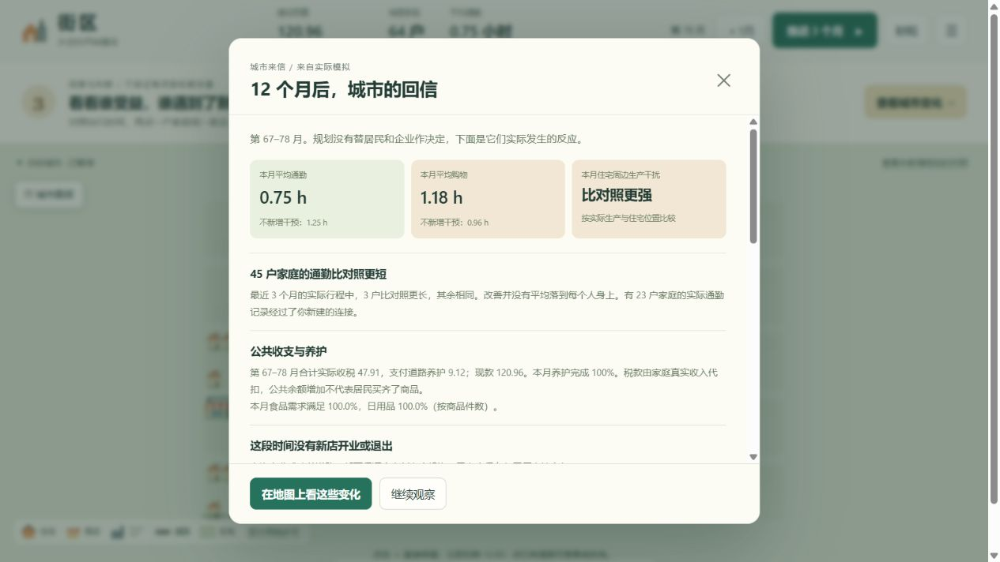

# 第42月至第78月：税收、道路与住商混合的续跑观察

日期：2026-10-28。使用 `6122d50` 对应的最新模拟代码。只运行与比较，没有修改经济机制。

本次读取玩家当前第42月存档：64户、4家工厂、1家营业超市、公共余额59.80、税率0%，15段普通道路，月养护需要0.60。住宅主要在西侧，工厂在东侧，道路连接沿南侧绕行。这里不是前次公共余额为零的那份布局。

本机原服务仍运行旧程序，存档没有新迁居规则字段。副本用最新代码加载后，两条对照均采用已发布的稳定迁居门槛；原服务和原存档没有被重启、调税或推进。

## 1. 先从同一第42月状态继续12个月

对照保持0%税；实验路线改为1%，没有补贴、建设或其他干预。到第54月：

| 路线 | 公共余额 | 养护完成率 | 食品数量满足率 | 日用品数量满足率 | 营业店数 | 12个月搬迁次数 |
| --- | ---: | ---: | ---: | ---: | ---: | ---: |
| 0% | 52.60 | 100% | 85.9% | 78.1% | 1 | 2 |
| 1% | 91.33 | 100% | 87.5% | 86.7% | 1 | 2 |

这一阶段起点已经有足够养护资金。税收主要提供公共储备，不存在“征税才恢复养护”的因果关系，也没有自动让城市买齐商品。

检查第54月主体记录，有10户未买齐至少一种商品。一些家庭购物时有足够现金，但附近超市货架已不足，剩下可用的工厂直销往返约5小时，超过4小时购物上限。超市实际卖出192件，工厂直销补充一部分，全城目标为256件。

## 2. 从相同第54月状态分出三条路线，均保持1%税

| 路线 | 干预 | 当时公共支出 |
| --- | --- | ---: |
| 维持原状 | 不再增加规划或道路 | 0 |
| 中部通道 | 新建15↔16、16↔17、17↔18、18↔19，即林荫里→中心里→中街→中部五街→中部六街 | 48.00 |
| 住商混合 | 将28号南郊西街从住宅改为住商混合，保留原有21户，允许在空余2单位土地上经营小店 | 2.50 |

中部通道的月养护需要从0.60增至0.76。没有直接放置新商店，也没有改变商品价格、库存、现金或工厂产量。

每条路线先跑12个月到第66月，再跑12个月到第78月。结果如下，满足率与通勤是最后6个月平均，公共余额和店数是第78月时点：

| 路线 | 食品满足率 | 日用品满足率 | 每户通勤 | 营业店数 | 公共余额 | 第55–78月搬迁次数 |
| --- | ---: | ---: | ---: | ---: | ---: | ---: |
| 维持原状 | 83.1% | 81.3% | 1.20小时 | 1 | 154.41 | 1 |
| 中部通道 | 100.0% | 99.6% | 0.71小时 | 1 | 120.96 | 9 |
| 住商混合 | 99.0% | 79.7% | 1.41小时 | 2 | 156.81 | 5 |

## 3. 为什么修路后没有新店，供货也能改善

中部通道缩短了住宅与工厂之间的绕行。一部分家庭原来买不到超市货后，无法在购物时间上限内去工厂；新路线让这种后备渠道变得可行。

第78月的实际交易为：

- 西南里超市卖出192件。
- 工厂向家庭直接卖出64件。
- 总消费256件，两种商品当月都满足100%。

后续工厂也根据真实订单、销量和可用劳动调整生产。这条路线没有新店进入，改善不是来自给商业区强行增加吸引力或库存。

有代价：24个月建设加养护开销更高，财政结余低于维持原状；平均购物时间约1.15小时，对照约0.82小时，因为更多家庭实际出行并完成购买，且一部分改去工厂。没有成功购物的人可能记零，所以更短的购物均值不等于更好。

住宅周边生产干扰指数末六期约0.064，对照约0.049。产量与住址分布都影响这个差异，不能只归因于道路直接产生污染。北侧两家没有现金的工厂仍停产，没有被自动救活。

## 4. 为什么混合用地只改善了食品

第60月，资金池在南郊西街投资了一家面积1、只卖食品的小店。原有家庭没有被驱逐，店铺利用该地空余土地进入。

这家店第66月仍出现过单期经营亏损；到第78月，当期售出26件、盈利3.05。不能把刚开店就等同于已经稳定成功。它扩大的是食品渠道，没有提供日用品，因此食品满足率明显提高，但日用品没有同等改善。

这个结果说明许可、空余土地、店铺规模和经营品类确实会限制经济反应。“多一块商业许可”不等于所有需求都解决。

## 5. 本次可以判断和不能判断的事

- 在这份布局里，单纯积累财政储备不能解决工厂与住宅间的绕行。
- 中部通道改善了通勤和工厂直销的可达性，且1%税收入可以覆盖新增养护；这不是所有布局都应采用的标准答案。
- 住商混合是一种较低公共支出的尝试，新增食品店有实际经营记录，但并未解决日用品问题。
- 迁居不再持续大范围重排；明显改变交通条件仍能触发一些搬家。次数是搬迁事件，不是不同家庭人数。
- 只测了当前一份存档，不能推广成“道路优于商业”“最优税率为1%”等一般结论。

## 6. 运行证据

中部通道路线通过网页实际建路、扣款，并两次推进12个月。浏览器最终第78月的玩家与对照完整模型快照，分别与独立运行得到的快照完全一致。所有检查的时期现金、食品和日用品守恒误差均为零。

原始存档、各路线第66/78月快照及汇总JSON保留在本机 `outputs/continued-play-20261028-223044/`。该目录是本地运行数据，不随Git上传；本文和截图随项目保存，换电脑可查看结论，完整重演需同时带上原始存档。

设计公式与运行顺序见[游戏运行逻辑总览](游戏运行逻辑总览.md)。
