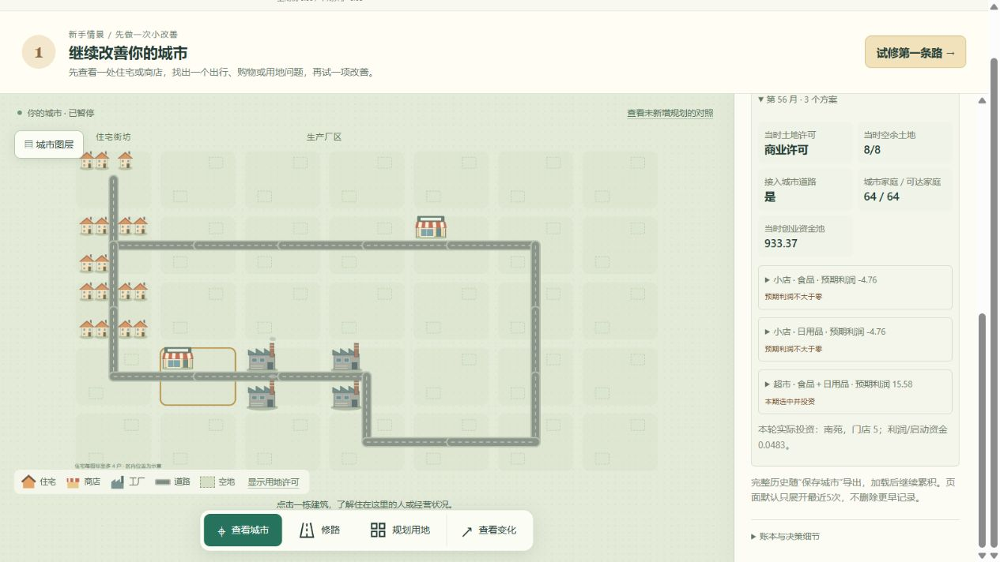

# 考察记录与当时的决策数值

最初版本增加观察与持久化；2026-10-29随后修正土地实验的商业考察候选与轮查顺序，利润、资金及交易公式不变。继续使用 `experiment/city-economy-lab` 分支。

## 在网页哪里看

点击地块，在“允许商业，为什么还没有店？”下面展开“商业考察记录”。默认列出最近5次，可继续显示或显示全部。每次再展开食品小店、日用品小店、综合超市的方案。

每份记录包括当时的许可、道路连通、空余土地、可达家庭和创业资金池。每个实际试算的方案保存：

| 项目 | 含义 |
| --- | --- |
| 预计销售收入 | 商品预测销量 × 预测售价的合计 |
| 进货成本 | 预测销量 × 最低出厂价的合计 |
| 运输成本 | 原模型对预测采购量计算的车辆与人工费用 |
| 租金、店员工资、固定经营费 | 当时的实际试算输入；工资同时显示预计工时 |
| 预计利润 | 收入 − 进货 − 运输 − 租金 − 工资 − 固定经营费 |
| 启动资金 | 周转资金 + 一次开业费，与经营利润分开列示 |
| 比较分数 | 本期预计利润 / 启动资金，非年化收益率 |
| 商品和货源 | 预测销量、售价、进价、最近供应商、当时库存、运输工时和车次 |
| 决策结果 | 选中投资、亏损、资金不足、可行但选择了其他地点 |

同次亏损且缺钱会同时保留两个原因。其他地点胜出时，显示实际投资地和胜出分数。旧版本没有许可、道路不通或土地不足时也可能留下抽样访问记录，明确没有执行利润试算。现版本在考察前排除这些地块，不让它们消耗名额，也不把筛选补成“利润为零”的考察。

现规则先筛允许商业、道路连通、空地至少1单位、没有营业店的候选。候选不超过8块则全部考察，超过8块则优先从未考察或最久未考察的地点，同期按编号排序，每期最多考察8块、投资1家。轮查进度随存档保存，轮候不等于失败，也不额外生成考察；全局关闭投资、直销模式或达到18店上限，会记录本轮跳过的原因。点击查看不会触发企业重新考察。

## 预测的局限仍然存在

这些是投资时的预期，不是保证实现的收入。保留了原模型的简化：最低出厂价与最近货源分别选择，预测不扣除实际缺货、没有完全处理多站购物。预测数量小于1时，原规则不会计运费；界面如实显示，并未为了让账好看而补算。价格与利润明细可以帮助发现这些简化是否值得调整。

## 家庭和工厂

点击家庭或工厂，展开“全部迁居考察”或“全部厂址考察”，查看每次比较的原址、候选、评分分项、改善门槛、当时现款、搬迁费和所有实际候选地点。留下的决策也保留。搬迁冷却期内没有实际评估，不生成虚构考察。

## 保存和旧存档

完整记录随城市存档导出、导入和自动保存。商业历史独立于最近12期的临时跟踪，不滚动删除；家庭与工厂考察也取消旧的256/96条截断，并保存全部候选评分。

旧存档已经丢失的历史无法恢复。导入时只迁移仍然存在的旧试算数值，标记为“旧版部分记录”；缺少的当时成本、资金、许可和最终选择标记未保存，不用当前状态重建。从载入后的下一期开始完整累积。新建城市从第1期记录。

此前全历史记录版本的240期、双世界测试存档约38.62 MiB，因此土地实验的导入上限改为64 MiB，原 `playweb` 默认上限保持16 MiB。历史越多，存档和推进前的复制开销越大。

当前已经运行的Python进程需要正常重启后才会使用新记录逻辑；仅刷新网页不会热加载Python。请保留自动存档并按原方式关闭、重新启动 `run-land.cmd`。

## 实现与验证

- `landlab/assessments.py`：投资决策发生当时的不可变数值副本，按地块、期次、方案保存。
- `landlab/model.py`：在原有访问与试算时记录，不增加随机抽样，不更改评分和交易。
- `landlab/session.py`：只读检查接口返回全部历史。
- `landlab/static/app.js`：摘要、成本分项、逐次历史、旧数据缺失提示。
- `tests/test_assessments.py`：利润与成本对账、全部方案结果、资格阻挡、查看不改变记录、快照延续一致、旧数据迁移、启用记录前后经济结果完全一致。

浏览器实测：30期测试城，北郊二街保留10次访问、30个方案。第28期食品小店预计收入1.24、成本8.62、利润−7.38，当时资金788.04、启动资金需求89.88；失败来自预期亏损，非资金不足。点“显示全部历史”可看到第1期，不局限最近12期。截图见 `player-ui/assessment-history.png`。

## 实际城市诊断：住宅与工厂之间的商业地为什么一直空着

2026-10-29检查的真实存档为种子1、第55期。目标是地图第四行第二列的商业地（内部编号22），住宅在左侧，工厂在其右侧。以下是个案诊断，没有修改经营规则或推进玩家的原城市。

### 证据与重放方式

从运行服务只读导出存档，副本保存在 `outputs/site-diagnosis/original-save.json`。根据相同种子和完整规划操作，从空白开局重放到第55期。重放后的全部核心经济快照（去掉观察与空间扩展字段后的整个快照）与真实存档一致，另外逐项确认居民、企业、资金和交通一致。

旧服务没有完整考察档案，因此第39—55期的结论来自这次验证一致的确定性重放，不冒充原存档已经保存的完整记录。重放和继续模拟只在副本进行。

### 直接原因：连续17期没有抽到这里

操作记录表明：第23期结束后修建住宅经21、22到工厂的连接；第38期结束后，将22号地改为商业许可。从第39到55期，没有一次抽到22号地。它此前最后一次被抽到是第38期，当时仍是保留地。

当前代码先排除已有营业店的地点，再从全城其他地块随机抽最多8个，抽完才检查许可、道路和容量。因此不允许商业的住宅、工业、保留地也会消耗考察名额。没有保证轮查，也不会因新规划或修路而优先考察。这一等待是抽样造成的，不能解释成企业17次认为该地无利可图。

### 当前条件试算：不是没有资格，也不是资金不足

以第55期结束时的条件额外作一次诊断试算（不是当期真实访问记录）：目标地接通道路、空地8单位、全部64户在购物时限内可达，资金池933.37。

| 方案 | 预计收入 | 总成本 | 预计利润 | 所需启动资金 |
| --- | ---: | ---: | ---: | ---: |
| 食品小店 | 13.76 | 18.46 | -4.70 | 89.60 |
| 日用品小店 | 17.67 | 22.36 | -4.70 | 89.60 |
| 综合超市 | 203.86 | 187.71 | +16.15 | 322.40 |

金额单位为块。综合超市预计各卖约66.19件食品和日用品。总成本包括进货158.85、运输7.46、租金6.40、人工14.00、固定费1.00；分项四舍五入与精确合计可能差0.01。小店和超市的经济性不同，不能用小店亏损替代整块地的判断。

“更近”也因住址而异：按当时含交通负荷的单程路线，最下方32户住宅到新商业地约0.90小时，到上方旧商业地约1.20小时；中间23户到新地约1.24小时，到旧地约0.86小时。新地更接近工厂和部分居民，并非对所有家庭都更近。

### 副本继续模拟的结果

不再干预，副本在第58期首次考察并选中22号地的综合超市，投资时预期利润35.86。它不是旧门店搬来：现有模型没有商店迁址，只有开业、经营和退出。

| 期次 | 这家新超市实际售出 | 本期账面结果 |
| --- | ---: | ---: |
| 58 | 154件 | +19.91 |
| 59 | 104件 | +0.42 |
| 60 | 38件 | -18.23 |
| 61 | 88件 | -9.11 |
| 62 | 56件 | -8.91 |
| 63 | 4件 | -142.14，因连续亏损退出 |

最后一期包含退出处理，不能将它当作正常开门成本。此结果证明此地会获得投资，也说明位置改善、正的投资预期都不保证持续盈利。后续又在第68、75期发生新投资，存在反复开关店的问题，需进一步分别检查预测偏差、销量波动、竞争、库存和退出规则；本次没有把关店原因都归咎于道路。

### 对玩法的判断

需要优先改进考察覆盖：先筛合法且连通、有容量的候选，再有界轮查，或为新规划安排一次近期评估。这样让玩家看到规划的经济反馈，同时保留“不赚钱仍不开店”的自主判断。商店迁址应单独讨论搬迁成本与收益，不应通过新规划直接强制搬店。以上为诊断时的建议；候选筛选与有界轮查已在下述修复中实现，商店迁址仍未实现。

## 2026-10-29修复验证：先筛合法候选，再轮查

`landlab` 使用上述新调度；底层 `commerce` 只提取可覆盖的候选选择入口，默认实现完全保留旧抽样算法，旧商业与网页基线继续适用。筛选是纯资格检查，不计入“真实经营考察”。每轮记录合法候选和本次考察列表，网页区分等待轮查与亏损拒绝。

用第55期真实存档的副本推进1期：第56期合法候选只有22、32，两块都被考察。22号地的食品/日用品小店各预计亏损4.76，仍被拒绝；综合超市预计盈利15.58且启动资金足够，实际获得投资。这里的15.58为第56期考察时的数字，和诊断时第55期末额外试算16.15不同，原因是下一期考察前会先收租和更新部分住址等条件。没有直接放置商店。玩家原存档未被测试推进或替换。

自动化验证覆盖：全部无商业许可时零考察、少量合法候选全看、超过8个时轮查覆盖、资金不足不强制投资、未连通/满地/已有营业店排除、新规划且从未看过的候选优先、保存恢复后的轮查连续一致、记录功能不改变决策结果。原有商业基线守恒和可复现测试继续运行。浏览器中实际核对新地的门店和“本期选中并投资”记录。

