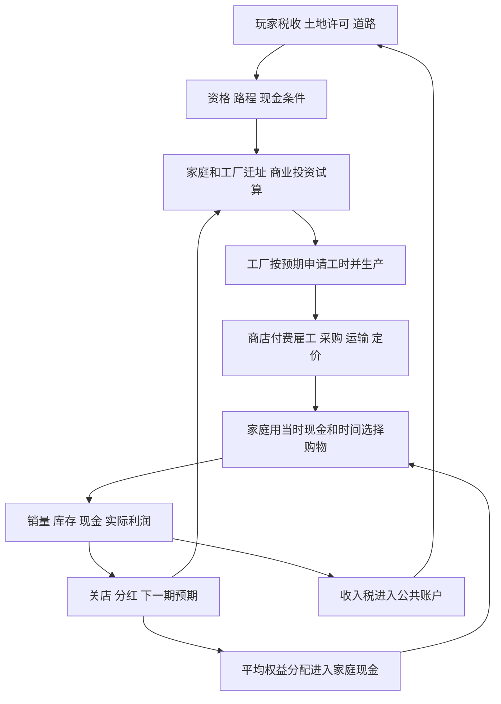

# CityEconomyLab 自下而上经济模拟代码审查

> 后续实现变更（2026-10-30）：按玩家要求，landlab 现已暂停门店、工厂、土地服务账户及投资池的全部自动分红，现金留在原账户。本报告的分红公式与实验是旧审查基线证据，不代表当前默认规则。暂停未新增替代支付或产权/服务经营主体；资金留存和家庭收入不足仍需观察。

审查日期：2026-10-29。代码基线：`299571521ea32d2f6f303e084295e2dd506df553`，分支 `experiment/city-economy-lab`。

**结论：当前项目已经有真实支付、库存、受约束的购物和经营反馈，是一个部分符合原则的主体模拟；当前网页还不是完整的城市劳动、投资与土地市场。没有发现为了保证繁荣而直接写入 GDP 增长或目标失业率的控制器。主要风险是：一些本来用于商业渠道实验的固定条件，被沿用成了整座城市的经济制度，却尚未建立对应主体与选择。**

最紧迫的两项是共享劳动池与自动平均收益分配。前者使就业不是家庭的自主选择，后者强烈决定谁有消费能力。统一采购报价缺陷已经修复，但开店预测仍基本忽略家庭现金，修正一个报价错误不等于企业预期已可信。

本轮只增加审查、可复现实验脚本和项目约束文档；未更改经济机制、界面、玩家存档或正式游戏。生产源文件的前后 SHA-256 一致，95项既有测试通过。测试及守恒不等于经济有效性或游戏性成立。

## 1 范围、判据及总评

### 实际运行的是哪套模型

当前网页链路是 `landlab.PlanningSession/LandSession → LandCity → PlayCity → commerce.City`。`landlab/__main__.py` 启动这一链路；`econlab.Economy` 是独立的早期实验，当前网页没有调用其就业、技能、补贴或公共采购机制。

代码方法集中在一个 `City` 类中，并不自动违背主体模拟。关键是数据和因果关系是否属于具体主体，以及是否受其信息、预算和资源约束；不是必须把每种行为拆成独立类。

三种规则要分别判断：

1. **微观规则**：主体根据报价、预期、库存、时间与现金选择行动；也包括道路通行、容量、技术等局部条件。
2. **统计规则**：从交易和状态汇总数量、均价、收入、出行等；统计可以成为主体可见信息，但不应凭空改写经济结果。
3. **人为结果控制**：为达到给定宏观趋势覆盖实际结果，或用没有相应主体过程的制度强制决定本应研究的结果。第三类需要严格审查；初始条件和技术参数本身不是第三类。

分类可在同一机制内并存：A为已符合，B为合理但有适用边界的抽象，C为与最终目标明显冲突的替代规则，D为尚未实现。C不等于查到了“隐藏GDP脚本”。

按层次判断，**交易执行层符合度较高，主体选择层部分符合，完整市场及长期发展层明显不足，游戏性仍待玩家实验验证**。这比给出一个没有定义的“符合百分比”更能说明现状。

| 机制 | 判断 | 不能超出证据的解释 |
| --- | --- | --- |
| 现金支付、实物生产、交易、库存与运输 | A，服务生产部分B | 钱和货确实流转；服务仍多为固定工时配方 |
| 家庭购物 | A+B | 能比较商品、路程、预算；不能代表丰富的家庭生活与储蓄选择 |
| 就业与工资 | 当前网页是C+D | 有真实工时工资，但没有自主择业、岗位竞争或稳定合同 |
| 制造生产 | A+B，动态产业过程D | 实际产量受工资支付和工时约束；工厂数量、技术、规模固定 |
| 工厂投资与退出 | D；把固定4厂称为涌现会成为C | 工业许可目前只能影响现有工厂迁址 |
| 商业进入与退出 | A+B，硬上限绑定时有C风险 | 利润与现款参与决策，但共享基金和全局节流决定机会集合 |
| 商品价格及预期 | B，报价一致性已修复 | 不能宣称市场出清或预期无偏；默认出厂价固定 |
| 土地许可与租金 | 许可A；租金B，房地产市场D | 许可改变资格；租金是占用量收费公式，不是竞价地价 |
| 家庭与工厂迁居 | A+B，受就业缺陷牵连 | 确有比较、搬迁支付和容量约束；不是换工作与搬家的联合选择 |
| 税收 | A+B | 对真实收入代扣；不直接给增长率或消费打折 |
| 财政支出 | A+B，完整服务生产D | 钱会支出回流，但建设未采购真实材料、未直接雇施工人员 |
| 产权与资金循环 | 守恒A；共享产权可作B；未声明地代表一般城市时是C | 自动返还不能冒充劳动收入、分散企业所有权或市场分配 |
| 宏观统计与解释 | A，另有统计口径问题 | 消费、劳动、店数是统计；当前网页没有正式GDP、失业率或土地售价 |

## 2 每期的真实因果顺序

主循环先清空本期工时与消费，再进入土地结算与考察，之后生产、商店经营、居民购物、收益分配、守恒检查和统计。具体顺序是重要的模型假设，不能当作无影响的实现细节。见[主循环](https://github.com/kukushu/game/blob/2995715/commerce/model.py#L668)、[土地阶段](https://github.com/kukushu/game/blob/2995715/landlab/model.py#L260)。

图中的劳动分配和平均权益分配都是现有规则，不是已经完成的劳动与资本市场。制造企业优先于零售雇工、食品优先于日用品花预算、分红晚于购物、交通使用上期负载，会产生顺序效应。

## 3 分机制审查

以下每项依次回答主体与约束、时点与信息、实际变化、现象及其来源、抽象和路径，并给出最小改进及验证方法。改进均为提案，本轮未实现。

### 3.1 家庭属性与购物

**主体与约束（1）**：`Resident` 实际字段只有编号、住址、时间估值、本期工时、购物时间和两种消费量；现金在账户中，环境偏好另存于 `LandCity`。没有年龄、技能、家庭人数、正式工作、房屋资产或消费耐用品。每种商品每期目标2件，现金不得透支，购物行程最多4小时。[字段](https://github.com/kukushu/game/blob/2995715/commerce/model.py#L55)、[属性初始化](https://github.com/kukushu/game/blob/2995715/landlab/model.py#L22)。

**何时、知道什么（2）**：在生产和商店经营后、家庭分红前购物。对有货且有柜台服务的卖家按商品价格和行程估值筛选，每种保留最多3个候选，再枚举食品与日用品组合；效用含商品效用常数650/500、价格和时间估值。只接受正效用组合。[购物](https://github.com/kukushu/game/blob/2995715/commerce/model.py#L523)。

**实际变化（3）**：支付购物款、扣卖家库存和柜台工时、增加家庭本期消费、记录道路流量。每期清空已消费计数是消费流量重置，不是把家庭现金或企业库存重置为目标。[付款和实物](https://github.com/kukushu/game/blob/2995715/commerce/model.py#L580)、[期初重置](https://github.com/kukushu/game/blob/2995715/commerce/model.py#L167)。

**现象与来源（4、5）**：买不齐、直销与零售份额、客流和平均成交价来自实际选择与交易。全城最大最终消费量被固定需求和人口限定为4N；需求上限不是涌现。食品先占预算、候选先截断，也会影响日用品不足，不能一概归咎于产业或居民偏好。

**抽象与路径（6、7）**：两种商品、有限搜索和时间估值是合理的最小消费模型，不必先增加几十种需求。相同居民能因道路、价格、缺货和现款不同走不同路径。但所有家庭需求相同、没有跨期储蓄目标、没有购买耐用品，当前不能研究消费升级。固定需求不等于强制买足，实际可以不买。

**最小改进和同初态对照**：先记录候选被排除的现金/路程/库存/服务原因，并对食品先买、反向优先、按家庭固定偏好排序做隔离对照；保持总需求与预算一致，观察日用品缺口是否主要来自遍历顺序。不要直接给日用品消费加成。

### 3.2 就业、工资与劳动分配

**主体与约束（1）**：企业是付款方，家庭提供可用工时；但当前没有职位、合同、工资报价或保留工资。时薪统一100分，家庭的工作加通勤不超过8小时。[基础劳动池](https://github.com/kukushu/game/blob/2995715/commerce/model.py#L198)、[空间版本](https://github.com/kukushu/game/blob/2995715/landlab/model.py#L158)。

**何时、知道什么（2）**：企业在生产、柜台、商店服务或运输阶段调用 `hire()`；系统从每期打乱的共同家庭顺序中分配尚有时间的家庭。它检查企业现款和路程，但不询问家庭工资与时间的取舍。同一家庭可为多个企业工作。

**实际变化（3）**：企业付真实工资，家庭获得现金并消耗工时，通勤产生真实路径和流量。`jobs` 只是本期各付款方分配工资的记录，每期开头清空，不是持续职业关系。[清空与引用历史工作](https://github.com/kukushu/game/blob/2995715/landlab/model.py#L260)。

**现象与来源（4、5）**：工资分布、通勤、生产是否得到工时确实有微观现金和时间基础；但谁得到哪家工作，主要由分配顺序和硬通勤约束决定。没有形成工资差异、主动换工作或失业者的求职选择。“本期工时为0”不能直接叫失业，也不能把平均工资收入图层当时薪图层。

**抽象与路径（6、7）**：共享池可以作为比较商业渠道所用的控制条件；把它作为自主劳动市场则明显不符合最终目标。不同道路确实改变可分配工时，但这不是居民在远处高薪与附近低薪之间选择。制造与柜台先于零售的招工顺序也应做敏感性检验。

**最小改进和同初态对照**：先加企业工资与有限岗位、家庭当前雇主，以及按税后工资减通勤估值的择业。保留小幅换职门槛，暂不加技能树。用旧池/岗位模型分叉；先用两个雇主的小案例验证工资差和通勤差能逆转选择，工资必须由企业真实支付。再比较工资、空缺、实际工作和家庭迁居，不指定目标就业率。

### 3.3 制造企业生产与招聘意愿

**主体与约束（1）**：工厂有现金、商品类型、标价、库存、销售与未满足订单记录，以及平滑预期。没有资本设备、员工合同、原材料、能耗、技术升级或独立容量资产。[工厂字段](https://github.com/kukushu/game/blob/2995715/commerce/model.py#L66)。

**何时、知道什么（2）**：每期用上期销售及未满足订单更新 `expected=0.6×旧值+0.4×信号`，按115%预期减现存库存计划生产，上限160件；申请每件0.25小时工时。库存先损耗，工厂按固定列表顺序生产并安排各自柜台。[生产](https://github.com/kukushu/game/blob/2995715/commerce/model.py#L407)。

**实际变化（3）**：实际工资和招到的工时决定实际产量，产量入库存；没有因为全城需要256件就直接把256写入产量。没有原材料的单劳动配方是一种明确的生产技术抽象，不是现金守恒错误。

**现象与来源（4、5）**：减产、库存积压、工时不足和供应短缺可由销售、财务和运输条件形成。技术系数、每厂产能和工厂数量是外生约束；没有设备投资时，不可能内生产生长期生产率增长。

**抽象与路径（6、7）**：指数平滑、库存缓冲和线性技术可保留。需要注意 `unmet` 不是所有潜在需求：主要记录有一定资金的商店未完成采购；没有完整记录居民所有可支付未成交需求，且其预算判定没有包含完整货运成本。[未完成采购信号](https://github.com/kukushu/game/blob/2995715/commerce/model.py#L497)。用这一信号解释完整市场需求会过度推断。

**最小改进和对照**：先统一“实际销售、可支付未成交订单、纯意愿”三类信号，并逐厂记录计划、工资预算、招到工时与差额。固定其他规则，切换工厂生产顺序及是否提前占用柜台工时；若产量优势随数组顺序交换，就不能说是企业竞争力。之后才考虑最小设备投资机制。

### 3.4 制造企业投资、扩张、进入与退出

**主体与约束（1、2）**：当前没有制造投资者的资金账户或项目决策。初始工厂固定4家，开城时根据工业许可、容量和到住宅用地的距离安排落点；不是算出利润后自主建厂。[初始化](https://github.com/kukushu/game/blob/2995715/commerce/model.py#L136)、[开城布局](https://github.com/kukushu/game/blob/2995715/landlab/planning.py#L85)。

**实际变化（3）**：开城一次性创建既定群体，之后工厂只能迁址、生产或停工。`Producer` 没有关闭状态，没有制造企业新增、扩建和清算流程。现金为0的工厂可以长期保持一个空壳实体。

**现象与来源（4、5）**：零产量和财务枯竭可以涌现；“工厂倒闭退出”和“新增工业投资”尚未实现。工业许可空置不必然是投资者认为不赚钱，也可能是根本没有新投资过程。工厂数量永远4是结构限制。

**抽象与路径（6、7）**：固定初始工厂适合局部实验，不是必须马上删除的错误；但不能用其评价产业成长、外资吸引或城市长期扩张。分散产业结构目前仅是两类商品初始各2家，不是行业进入的结果。

**最小改进和对照**：在就业机制之后，仅做一个已有资金的投资主体、一种小工厂模板、真实建厂付款和可退出工厂。先不加银行或跨国产业链。外资应有显式外部账户和资本流入记录，不能凭空给本城工厂钱。比较低地租与高地租时投资主体是否因预期及预算不同而改变选择；允许两组都无投资。

### 3.5 商业进入与投资选址

**主体与约束（1）**：`fund` 是共享资本账户，相当于一个统一投资者，而不是多家独立创业者。它用现金支付周转金与手续费；店面只有面积1或4，商品组合受店型限制。每地只允许一个营业店进入候选。[投资](https://github.com/kukushu/game/blob/2995715/commerce/model.py#L370)。

**何时、知道什么（2）**：在当期生产之前考察。`landlab` 先筛商业许可、道路、土地和无营业店，最多评估8块，优先从未或最久未考察者；对合格方案按利润/启动资金选择一家。其需求预期使用全城家庭位置和时间估值以及全部现有标价，信息范围比局部经营者宽。[轮查](https://github.com/kukushu/game/blob/2995715/landlab/model.py#L96)、[预测](https://github.com/kukushu/game/blob/2995715/commerce/model.py#L333)。

**实际变化（3）**：确实划转投资本金、手续费，创建门店，之后需雇工进货才形成货架和销售。规划商业用地不会直接生成店或宏观商业需求。

**现象与来源（4、5）**：是否盈利和资金是否足够是真实约束；具体店数还受每月最多一家、同时最多18家、考察8块、地块排他及共享基金资金量限制。商业会在需求与物流条件不同的地点开业，没有邻店吸引加成，但其分布仍依赖全局搜索与评分规则。[上限与准入](https://github.com/kukushu/game/blob/2995715/commerce/model.py#L370)。

**抽象与路径（6、7）**：考察预算可以是合理注意力或实施能力抽象，不必为了ABM取消。18家上限若绑定，就直接截断企业数量结果；未绑定则不能拿它解释当前店数。本轮6个搜索案例的营业店峰值5—6，18上限触发0次。单一基金与统一ROI排名限制并行创业，也限制从工资储蓄转为投资的反馈。

**最小改进和对照**：保留轮查，但记录上限命中、候选遗漏和资金阻挡。对8块与全部合法地块做同初态分叉，再单独比较一家与有限并行投资；不同时改盈利阈值。若研究创业主体差异，只增加少量资金独立的投资者即可，不需要证券市场。

### 3.6 商店经营、补货、定价和退出

**主体与约束（1、2）**：店有现金、有限库存、柜台工时、分商品预期和单位采购成本。按历史销量更新预期，以110%预期为补货目标；商品分配固定货架份额，按进货成本加固定费摊销和利润额试探调价。[经营](https://github.com/kukushu/game/blob/2995715/commerce/model.py#L435)。

**实际变化（3）**：租金、店员、货运和商品采购均实际支付；库存不足、买不起或雇不到货运劳动就不能到货。批次报价排序用一笔目标采购量，之后订单可因库存和现金被缩减，没有重新求解所有供应商组合，因此不是全局最优采购。

**现象与来源（4、5）**：缺货、积压、经营亏损、门店退出和渠道份额有实际交易基础。利润按现金变化加库存成本价值变化计算；退出会核销剩余库存并返还剩余现金。[结算](https://github.com/kukushu/game/blob/2995715/commerce/model.py#L633)、[清算](https://github.com/kukushu/game/blob/2995715/commerce/model.py#L621)。

**抽象与路径（6、7）**：规模对应容量48A、人工2+3A是可解释技术参数；小店只卖一类、大店可卖两类则是额外的组合限制，可能强化大店的连程购物优势，不能把规模胜出全部说成自然规模经济。6期缓冲后连续亏损4期关店、连续两期付不起开门费退出是启发式，不是完整破产法。没有主动缩店、换址或主动扩张。

**最小改进和对照**：先使用已有 `small_multigood` 做同商品组合对照，另做退出门槛敏感性分析，保持现金、需求和技术成本不变。检验小店失败是否来自强制商品限制。保护真实清算与守恒，不以“店数太少”自动延长亏损生命或补钱。

### 3.7 工厂价格、零售价格与经营预期

**主体与约束（1、2）**：默认工厂食品价100分、日用品140分固定；开启 `factory_prices_adapt` 才按未满足订单或积压每期增减约1%。零售价按本店成本和预期销量逐步调整，不是市场出清求解。[工厂价格](https://github.com/kukushu/game/blob/2995715/commerce/model.py#L407)、[门店价格](https://github.com/kukushu/game/blob/2995715/commerce/model.py#L455)。

**实际变化（3）**：报价影响居民实际选择、商店采购和支付金额。报价本身不创造收入，只有卖出和付款才改变现金。初始最低出厂价仍是试探零售价的定价基准，不代表一定能以该价进货。

**现象与来源（4、5）**：平均成交价来自真实交易，但默认固定出厂价限制通胀、工资价格联动等现象。企业预期中的需求函数是对微观买家行为的近似，不是实际消费；它不检查家庭现款，也未预测真实可供库存、运输用工或完整连程购物。

**已修复与仍受限（6）**：最低出厂价拼接最近厂运费的缺陷已在本基线修复，共享同厂同批报价；正但不足1件也计批次运费。剩余的库存供给假设已明示，不能再把计算错误称为有限理性。[统一报价与成本](https://github.com/kukushu/game/blob/2995715/commerce/model.py#L286)。当前利润预测仍可能系统性乐观，不因代码一致就可称可信。

**路径与最小对照（7）**：本轮把家庭初始现金转到财政账户后，投资需求预期完全不变，首期实际消费却大幅下降。这说明预期缺少购买力约束。下一步先将预测误差拆成销量、售价、货源、人工和费用项；用实际售出与可支付未成交订单校准，而不是假定企业知道全城私人账户。全知预算预测可作为诊断上界，不应默认赋给经营者。预测改善必须在相同冻结状态及留出种子评估，不能只比较新旧路径中不同店的平均误差。

### 3.8 土地许可、住宅租金与企业租金

**主体与约束（1、2）**：玩家决定使用许可与道路；家庭、商店和现有工厂在有限容量内竞争地点。住宅按每4户1单位取整，商店1或4、工厂4，每地8单位。`property` 收款但没有房东、开发商或土地报价决策。[容量及资格](https://github.com/kukushu/game/blob/2995715/landlab/model.py#L75)。

**实际变化（3）**：改许可要付2.50，修路12.00、改良9.00，资金进入 `property`；资格和路程改变后续选择，既有主体不会被强制驱逐。住房每期尽现金支付租金，不足部分没有租金债务或驱逐。[玩家干预](https://github.com/kukushu/game/blob/2995715/landlab/session.py#L70)、[收租](https://github.com/kukushu/game/blob/2995715/landlab/model.py#L260)。

**现象与来源（4、5）**：住宅聚集、共享容量挤占、空置许可可由真实选址产生。住宅报价 `55+3×住户数+5×已用土地` 分、企业租金 `round[(160+1.8×附近家庭数)×面积×倍率]` 分，是预设报价规则；随聚集变化不代表竞价地价。[住宅租金](https://github.com/kukushu/game/blob/2995715/landlab/model.py#L134)、[企业租金](https://github.com/kukushu/game/blob/2995715/commerce/model.py#L257)。

**抽象与路径（6、7）**：用占用度收费模拟稀缺性可以作为B类抽象，地价、房价、房地产供给则未实现。当前住宅不做“不交租后欠债”选择，实缴与报价可能不同；评分按报价而非实缴。商业占地也提高住宅收费，是显式外部性参数，不是房东观察市场后加租。

**最小改进和对照**：先把界面和报告中的“地价”严格限定为没有实现，保留租金报价口径。要研究租金市场时，只加一个有限房源房东按空置与收租情况调整报价，与现有公式做分叉；不直接令全城地价随GDP上涨。保持总可住容量相同，分离供给变化与价格规则。

### 3.9 家庭迁居和工厂迁址

**主体与约束（1、2）**：第7期起，每期约10户被抽到考虑迁居；比较当前房租、报价与购物时间、上期分配的工作地点和生产干扰。默认须改善超过 `max(50分,当前综合评分10%)`，有1.20搬迁费，搬后等待4期。工厂每期轮到一家，比较预计利润，须改善超过4.00、有12.00且等待8期。[家庭](https://github.com/kukushu/game/blob/2995715/landlab/model.py#L184)、[工厂](https://github.com/kukushu/game/blob/2995715/landlab/model.py#L238)。

**实际变化（3）**：发生搬迁付款、住址/厂址变化和真实土地占用变化。没有直接指定“某区应有多少人口”。干扰来自上期产量与距离的局部指标，没有强行加入工业区永久讨厌值。[住房评分](https://github.com/kukushu/game/blob/2995715/landlab/model.py#L141)、[干扰](https://github.com/kukushu/game/blob/2995715/landlab/model.py#L138)。

**现象与来源（4、5）**：迁居、产业与居住冲突、迁移缓慢都可由这些选择形成，但搬迁频率受抽查、阈值和冷却明显限制。有限总人口只有重分布，没有外来迁入或家庭形成。当前干扰是指数，不是有排放存量、风向或健康作用的污染过程。

**抽象与路径（6、7）**：阈值与冷却可解释为搬迁摩擦；它们抑制小波动，并不证明底层搬家理由正确。上期工作不是稳定合同，家庭可能为不会持续的工作迁居；没有比较原址换工作。工厂厂址评分用粗略需求、均分潜在劳动和固定利润公式，也不是对真实排班与资金的前向模拟。[厂址评分](https://github.com/kukushu/game/blob/2995715/landlab/model.py#L215)。

**最小改进和对照**：优先建立最小工作关系后，再比较“原址找工作”与“保留工作搬家”的净改善，不先做完整联合优化。保留迁居费用，分别关闭/启用阈值和工作稳定性，记录因哪项成本变化搬家；检验降低搬家次数是否只是把错误选择冻结。工厂先对每次选址的预期用工与实际用工做误差分解。

### 3.10 税收与政府预算

**主体与约束（1、2）**：政府由玩家调税，工资和两类家庭分红逐笔代扣0—30%，按整数分向下取整。税不是直接从企业利润扣，也不没收既有存款。政府不能透支，没有借债、外部收入或自动救助。[代扣](https://github.com/kukushu/game/blob/2995715/landlab/model.py#L56)。

**实际变化（3）**：款项从家庭转到 `civic`，总现金不变；未来居民预算与政府可支付能力改变。税率变动不立即覆盖消费、产量或就业统计。

**现象与来源（4、5）**：高税可能逐步挤压购买力，低税也可能耗尽养护预算；是否出现取决于原有现金、需求和支出。本轮24期三个种子中，30%明显改变现金归属，但两个种子的消费均值不变，另一个只轻微下降。不是写死的“税高立刻衰退”。

**抽象与路径（6、7）**：比例税和整数舍入是合理抽象；只对收入征税、现金封闭则是明确制度与边界。当前没有支出充足的政府服务体系，持续高税主要积累公共余额。以前第103期高税复盘是在另一初态、较长时期和旧商业版本下进行，不能把它的数值当作本轮通用结论。[旧个案](../TAXATION.md)。

**最小改进和对照**：先做真实、有限预算的一个支出渠道，例如采购已有商品或按明确规则给家庭转移支付；单独比较留存税款与支付同额支出。收入税率保持相同，核对支付对象、消费变化和税源，不直接给“公共支出乘数”加到产出上。

### 3.11 财政支出、道路和公共服务

**主体与约束（1、2）**：玩家修路、改良与改许可先付费，每期开头按道路等级收取维护费。欠付维护影响本期通行时间；没有承包商、建设岗位或材料订单。[支出](https://github.com/kukushu/game/blob/2995715/landlab/session.py#L70)、[维护](https://github.com/kukushu/game/blob/2995715/landlab/model.py#L260)。

**实际变化（3）**：真实现金转到 `property`，道路边和等级改变。路程使用基础时间、道路等级、已付维护比例和上期真实流量；升级系数0.55是通行技术抽象，不是经济增长加成。[通行](https://github.com/kukushu/game/blob/2995715/landlab/model.py#L109)。

**现象与来源（4、5）**：道路可以改变可达性、采购费用、可工作时间和消费机会，后续经济反应来自微观约束。建成速度和维护效果来自固定收费及技术系数。修路支出没有直接招到施工工人，不能据此说它创造了建筑就业；款项回流来自结算中的平均分红。

**抽象与路径（6、7）**：即付即建适合验证规划游戏，保留即可，但应标明“建设服务抽象、材料劳动未模拟”。维护不足把时间最多乘2是有限退化规则，不是真实道路工程模型。玩家可规划无效道路或仍无法吸引商家的用地，不保证成功，这点符合目标。

**最小改进和对照**：先区分通行改善效应与花钱回流效应：一组真实修路，一组支付同额无通行改善的维护/建设服务费用，一组不行动；资金接收者一致。若研究施工带动就业，再加受工时或商品约束的一个施工队，而不是全城就业加成。

### 3.12 产权、分红、储蓄及资金循环

**主体与约束（1、2）**：实际存在家庭、工厂、商店、`property`、`fund`、`civic` 账户，但土地服务和基金没有独立所有者选择。每期工厂把现金超过80.00部分的一半转入 `property`，后者几乎全部平均分给家庭；商店多余储备的一半转给基金，基金仅把超过初始资本1800.00的余额均分。[收益分配](https://github.com/kukushu/game/blob/2995715/commerce/model.py#L633)。

**实际变化（3）**：所有分红均有付款方，不创造货币。租金、开店费、搬迁费、道路及规划支出、车辆租赁等资金先汇入 `property`，再流向全部家庭。基金缺钱不会自动获得居民储蓄或财政注资。

还有一个需明示的基准差异：土地版把初始1800.00基金中的300.00拨给市政，开城基金剩1500.00，但基金分红门槛仍按设置中的1800.00计算。这不违反守恒，却不是“基金超过开城实际资本就分红”；是否保留这一储备基准应明确说明，不能混称同一个初始资本。[土地版初始划分](https://github.com/kukushu/game/blob/2995715/landlab/model.py#L40)。

**现象与来源（4、5）**：现金分布、消费缓冲、基金耗尽与政府留存确实来自真实流量；但“所有家庭持有相同权益、收费收入几乎全部返还、固定工厂储备”是预先规定的产权和分配制度。部分支出只是等额转移，不是有成本承担者的净服务利润。不能把这条回流当作市场自动消除失业或资本分配问题。

**抽象与路径（6、7）**：共享所有权作为商业渠道对照合理，分红本身也完全可以符合ABM；目前把它无条件用在一般城市、却没有所有权与服务成本解释，是严重的目标冲突。它能使大量本期没工作的家庭继续消费。关闭分红会让钱滞留 `property`，不是正确模型的证明；实验只说明该产权假设非常重要。

**最小改进和对照**：先明确服务账户的收费、成本、净盈余及家庭权益权重，记录分红决策与留存用途；无需先建股票市场。用相同现金总量、同初始状态比较等额权益、显式不等权益、不同留存规则，观察收入分布、消费和投资。保持相同总分配额的权益对照能进一步区分总量回流与分配结构。不要用补发现金确保消费恢复。

### 3.13 宏观统计、观测与结果解释

**主体及数据（1—3）**：统计器汇总家庭已消费、付过的价格、企业实际库存/利润、真实劳动与路流；图层从支付记录汇总工资和税后收入。统计器不替代主体交易，也没有反向覆盖其现金。[统计](https://github.com/kukushu/game/blob/2995715/commerce/model.py#L704)、[只读图层](https://github.com/kukushu/game/blob/2995715/landlab/layers.py#L13)。

**现象与来源（4、5）**：满足率、零售份额、实际产量、店数、平均成交价是统计结果。没有正式GDP、房价、地价或当前网页就业率。消费额不是GDP，不能把批发与零售再次相加当增加值；新增正式GDP需定义商品中间投入、零售服务增加值、库存变化和真实政府服务，不能先设增长率。

**口径风险（6）**：`total_hours` 只计劳动加购物，空间模型另记通勤，因此它与 `hours_per_unit` 未包含家庭通勤。种子1探针末期漏计49.0752小时，不应当作完整社会时间效率。单店或无店时“最近其他店距离=0”也不代表集聚最强；预算不足标记是启发式，不是严格原因识别；关店期全局利润含库存核销而店的观察表先记录核销前利润，比较时必须对齐。

**路径与最小改进（7）**：保持观测与模拟分离；先补指标定义、分母与时点、空值语义和来源映射，给“零工时家庭占比”正确命名，不等同失业。以后可以增加统计，不需要为了画GDP曲线修改主体。某主体依据公开统计调整行动可以合法存在，但应记录其信息与实际预算，不能把统计目标直接写回结果。

## 4 本轮实际实验及证据

复现：在项目根目录运行 `python tools/audit_bottom_up.py`。默认种子1/7/23，各24期；只用临时内存副本，固定选址模式以隔离指定规则。原始文件为 `outputs/bottom-up-audit/evidence.json`，含代码版本、源文件前后哈希和完整汇总；本次审查的[固定证据快照](audit-data/bottom-up-2995715.json)随报告提交，便于其他电脑复核。本文数字均来自本基线的新实验，不套用旧版玩家案例。

### 4.1 统计不控制物理状态

三个种子检查图层、视图和家庭详情前后，完整快照不变。另给副本统计结果附加一个极大的仅审查用指标，运行3期后，除这个统计字段外的快照完全一致。它是本轮审查探针，不是加入正式模型的GDP字段。这支持当前指标是输出而不是宏观结果控制器，但不能穷尽所有未来路径。

### 4.2 家庭时间偏好不参与劳动选择

同初态仅将全部家庭的时间估值乘100，第一期每户工作与雇主分配完全相同；三个种子正常购物总时间约204.96—209.34小时，处理组均为0。购物会响应时间估值，工作分配不响应，直接印证自主择业缺失。该极端参数只做机制诊断，不用作游戏平衡值或现实效应估计。

### 4.3 预期对购买力不敏感

在相同初始地图和报价下，将全部家庭初始现金转到财政账户，总钱不变。节点7综合超市的利润和需求预测三种子均完全相同；实际第一期交易却不同：

| 种子 | 原态消费额 | 转走家庭现金后 | 原态消费件数 | 处理后件数 |
| --- | ---: | ---: | ---: | ---: |
| 1 | 273.60 | 79.00 | 232 | 67 |
| 7 | 276.40 | 76.20 | 234 | 65 |
| 23 | 256.80 | 77.20 | 220 | 66 |

这是流动性条件的极端干预，不是实际税改，也不是同一个经营者已知全部账户的假定。它证明实际交易受预算约束、当前需求预期不受该约束；后续要检验经营者用可获得的信息如何修正误差。

### 4.4 自动分红强烈改变消费与现金分布

保持初态、工资、生产和购物规则一致，一组照常分红，另一组仅在审查副本中暂停两类家庭分红，钱保留在原账户。没有为任何组补钱，工厂转入服务账户等其他支付保留。

| 种子 | 正常平均消费/期 | 暂停分红平均消费/期 | 正常期末家庭现金 | 暂停分红后 |
| --- | ---: | ---: | ---: | ---: |
| 1 | 150.47 | 93.68 | 3112.27 | 1.55 |
| 7 | 151.83 | 99.07 | 3062.06 | 2.32 |
| 23 | 148.20 | 95.08 | 3139.40 | 2.12 |

正常组最后一期工资合计44.50—50.25，分红165.12—181.76；51—54户没有本期工时。可见资金循环不是细枝末节。暂停分红组不是建议采用的新制度，它引入了资金留存；未来需做固定总分配额的所有权权重对照，不能把本实验当成“分红错误”。

### 4.5 高税并不直接指定消费下降

相同初态0%、1%、30%三组，种子1的24期平均消费均为150.47，但期末政府现金分别263.52、311.35、2065.69；种子23消费也相同，种子7的30%消费均值仅从151.83变为151.53。初始余额、时间和供给约束尚未被完全替换成现金约束时，高税先改变存量归属，消费未必立刻变化。这与较长时期、高消费初态下出现现金紧张并不矛盾。

### 4.6 搜索预算影响商业路径，但不保证更好

同一全开放用地初态，分别每期看最多8块和看全部合法候选；保持每期最多投资一家、ROI、现金和退出规则一致：

| 种子 | 8块组进入/退出 | 全部候选组进入/退出 | 平均消费额，8块/全部 |
| --- | --- | --- | --- |
| 1 | 14 / 11 | 15 / 13 | 388.84 / 382.96 |
| 7 | 11 / 6 | 11 / 8 | 396.60 / 391.43 |
| 23 | 13 / 11 | 10 / 5 | 385.27 / 405.62 |

结果没有一致方向；名义消费更多也不是自动更有福利。需要把注意力预算视作行为假设并做敏感性检查，不能说所有店数变化都完全来自盈利，也不能说搜索越多越繁荣。两组营业店峰值均不超过6，18家上限在这些案例中没有绑定。

所有分红、税收和搜索实验的现金及实物守恒误差为0。它们支持交易账本正确，不证明制度假设正确。三个种子、固定地图和24期没有统计总体代表性，结果是机制探针而非经济学普遍规律。

## 5 早期 econlab 可以参考，但不能冒充当前能力

早期 `econlab` 的家庭确有技能、工作ID，企业有工资、价格和所有者；先留用/裁员，再由求职家庭按税后工资减通勤成本比较岗位，并有换职门槛。[劳动市场](https://github.com/kukushu/game/blob/2995715/econlab/model.py#L318)。工资根据空缺和经营状态调整，老板用自己的现金重新投资，企业能关闭后重启。[经营和投资](https://github.com/kukushu/game/blob/2995715/econlab/model.py#L263)。

它还存在真实财政转移支付和从企业库存购买商品的公共项目，工程进度由实际采购数量累计，桥梁完工再改变交通条件。[补贴](https://github.com/kukushu/game/blob/2995715/econlab/model.py#L371)、[公共采购](https://github.com/kukushu/game/blob/2995715/econlab/model.py#L419)。这些思路比直接加GDP更贴近目标，值得作为小机制的候选，而非整套移植。

早期模型也有边界：4个抽象城区、固定潜在企业槽位、关闭4期后用45.00本金重启、行业初始工资价恢复、受培训月数规则直接把技能置为1.15、固定收入/财富消费预算比例、外生食品生产率冲击。它不是已完成的一般经济模型；这些需分别解释为制度、技术或情景条件。其就业、基期价格产出和现金基尼是统计结果，不能直接当GDP。[培训](https://github.com/kukushu/game/blob/2995715/econlab/model.py#L241)、[旧指标](https://github.com/kukushu/game/blob/2995715/econlab/model.py#L494)。

## 6 最小改进顺序与验收实验

本轮不实施这些改造。每一步应保留旧规则作对照，先确认产生玩家可理解的选择，再考虑下一步。

| 优先级 | 最小改动候选 | 同初态实验与应观察的链条 | 玩家获得什么 |
| --- | --- | --- | --- |
| P0 | 最小岗位、企业工资、家庭当前工作与换职门槛 | 改一家的工资或通路 → 申请/接受/拒绝变化 → 企业实际工资与用工 → 产量；不改就业统计 | 能判断缺工是工资、通勤还是岗位不足 |
| P0 | 明示产权、服务成本和分红留存 | 相同总资产与总分配额，改变权益归属；再单独改变留存率 → 各户预算和消费 → 企业收入 | 明白失业者为何仍有收入，谁负担费用、谁获益 |
| P0 | 预测误差与指标口径 | 冻结相同报价/状态，对齐销量、成本、核销和时间口径；以真实后续交易评分，不以开店数评分 | 看懂开店失败来自哪里，而非只有“利润不足” |
| P1 | 一个有预算的财政支出渠道 | 同税率，留存与真实支付同额税款；同额无通路效应支出与修路分开 | 比较囤钱、救济或修路的真实机会成本 |
| P1 | 先换工作或搬家的两个有限候选 | 原址求职与保留工作迁居，分别计算净改善、费用、落地后兑现程度 | 有明确的就业与住宅规划取舍 |
| P2 | 一个可进入/退出的小制造项目 | 显式投资者资本、施工费用和工厂预算；改变土地成本后允许进入、失败或不进入 | 工业规划真正成为邀请投资的条件 |
| P2 | 最小房东报价或房源供给 | 容量固定比较收费公式与空置反馈，再单独放开供应 | 租金变化有可识别的定价主体 |

每个实验使用保存的同初态和同种子分叉；记录资金来源、信息时点、被拒理由与资源守恒。至少覆盖不同产业距离、居民分布、初始财富和留出种子，检查调度顺序、时间步、搜索预算、退出阈值等敏感性。不能因为一组没有出现预期现象就另加宏观补正。

当前的固定家庭数、固定生产技术、固定货币边界，可以继续用于有限实验，但必须写在实验假设中。开放人口、外资或信贷时需显式来源账户和数量记录；封闭经济的现金守恒断言也应随明确开放边界调整，而不是偷偷停掉检查。

## 7 游戏性与解释能力的验收

已有界面能点击家庭/商店/工厂看成交与收支、逐次选址、道路和商品满足情况，也能改变土地、道路和税率。这建立了观察和干预入口，不证明决策已经有趣。当前大量属性同时展开也可能增加阅读负担。

后续每个机制只设计一个短任务，例如“附近工厂缺工”“商店有客流但缺现金”“政府有余额而家庭买不齐”。初态只提供问题，不写死繁荣结果；玩家应先提出可检验解释，选择两种不同成本的干预，再看主体拒绝/接受和实际成交。验收应看玩家能否解释一项成功与失败、能否找到受损群体、能否修正原判断，而不只是指标变绿。

不要先补银行、几十种技能或完整房产市场来追求真实性。优先把工作、收入来源、开店预期与真实购买接上，让“观察 → 理解 → 干预 → 主体响应 → 再判断”的循环成立。

## 8 对未来架构的硬约束

长期约束已写入项目根目录 [AGENTS.md](../AGENTS.md)。核心不是“禁止公式”，而是每个经济变化能追溯到谁的状态、信息、决定和资源变化；统计只陈述结果。任何未来加成都必须解释为主体真实面对的技术或条件变化，且不保证成功。没有发现直接宏观增长脚本，不等于目前所有结果都可以解释为自主市场涌现。
